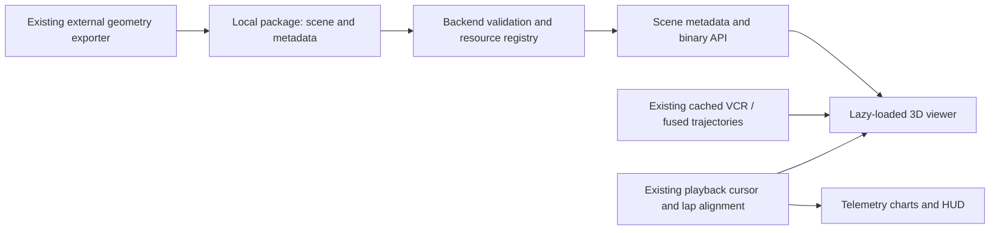

# Simplified 3D replay with camera controls

Status: **Proposed — analysis and delivery plan; no implementation started**  
Reviewed: **2026-10-15**, against checkout `b2d95bfc`  
Scope: a simplified game-like replay inside the telemetry studio, using exported local-plugin 3D track geometry, simple cars, camera controls and existing deterministic analysis.  
Dependencies: one representative export from the existing external geometry export mechanism; a documented mesh coordinate/material contract; browser WebGL support; validated replay pose placement.  
Next step: inspect one exported circuit and build a small scene/pose alignment spike before committing to the package schema.  
Completion gate: the exported circuit, primary car and comparison ghost remain aligned while playing, scrubbing and changing cameras; telemetry stays synchronized; package failures preserve the existing 2D experience.

## 1. Recommendation

**This is feasible. Build the replay viewer into the app and extend the existing data-plugin system to supply the 3D scene.** The target is a recognizable, simplified game-like track: road, kerbs, runoff, selected barriers and useful landmarks, with clear racing lines and simple car bodies. Exported geometry should be the main visual surface, rather than reconstructing a circuit from 2D map polygons.

The user confirmed that an export mechanism already exists for putting 3D geometry into the plugin. Treat export as an available upstream capability. Its implementation and a sample 3D output were not present in the reviewed checkout, so output format, alignment, materials and performance remain validation items, not reasons to plan a new extraction project.

The replay decoder already provides positions and rotations. The substantial new work is the scene renderer, asset delivery, pose validation, camera behavior and integration with the inspector. A new game engine or physics simulation is unnecessary.

**The plugin supplies content; the application owns rendering and interaction.** Today this is a validated local data-package system, not an executable extension host. A downloadable UI plugin framework would add substantial scope without helping this feature's first release.

## 2. What the current code already provides

| Capability | Evidence in this checkout | Consequence for 3D |
|---|---|---|
| Recorded car position and orientation | [`ReplayTrajectoryPoint`](../../shared/types/replay.ts), [`decodeReplayPose`](../../server/replay/decode/replayPose.ts), [`buildTrajectoryPoints`](../../server/replay/decode/replayLapPoints.ts): `x/y/z`, `rotX/rotY/rotZ`, time and inputs | No new VCR channel decoding is initially required. Euler rotation order and model origin still need validation. |
| Retained replay trajectories | [`replayTrajectoryCodec.ts`](../../server/core/replay/replayTrajectoryCodec.ts), [`dbReplayTrajectoryStore.ts`](../../server/core/replay/dbReplayTrajectoryStore.ts) | Reuse cached laps, including retained data whose VCR was deleted. Check field availability on older rows rather than requiring a reparse. |
| Higher-rate telemetry with replay pose | [`telemetryFusion.ts`](../../server/telemetry/telemetryFusion.ts) interpolates VCR XYZ and all three rotations onto DuckDB timestamps | A 100 Hz fused trace does **not** mean 100 Hz measured spatial detail. Pure DuckDB reader points currently contain placeholder coordinates, including `y: 0`; source availability must govern 3D eligibility. |
| Shared timed playback | [`replayPlaybackClock.ts`](../../src/components/replay/inspector/replayPlaybackClock.ts), [`replayPlaybackCursor.ts`](../../src/components/replay/inspector/replayPlaybackCursor.ts) | Subscribe the 3D scene to the existing playhead. Do not create a second replay clock. |
| Lap comparison and spatial alignment | [`useGpsSceneDynamics.ts`](../../src/components/replay/map/scene/useGpsSceneDynamics.ts), [`lapAlignment.ts`](../../src/utils/lapAlignment.ts), [`replayComparison.ts`](../../src/utils/replayComparison.ts) | Reuse station alignment and delta calculations; separate these from SVG-specific projection where needed. |
| Metric road profiles | [`trackGeometry.ts`](../../shared/types/trackGeometry.ts): elevation, banking, left/right edge elevations and kerb profiles | Useful for validation and overlays. Fields are optional or nullable; this does not prove every installed package has complete measurements. |
| Model-sized 2D car envelopes | [`dataPlugin.ts`](../../shared/types/dataPlugin.ts), [`GpsSceneCarMarkers.tsx`](../../src/components/replay/map/scene/GpsSceneCarMarkers.tsx) | Simple 3D cars can reuse dimensions and outlines, but the current offset is XZ only and does not establish a 3D pivot. |
| Optional local packages | [`DataPlugin`](../../server/plugins/dataPlugin.ts), [`trackPackage.ts`](../../server/plugins/trackPackage.ts), [`dataPluginRoutes.ts`](../../server/routes/dataPluginRoutes.ts), [package documentation](../PLUGINS.md) | Extend established identity, validation and revision handling. There is currently no binary scene loader or static package mount. |
| Resolution control | [`telemetryResolution.ts`](../../src/components/replay/telemetry/telemetryResolution.ts), [`trajectoryDownsampler.ts`](../../server/replay/decode/trajectoryDownsampler.ts) | Inspector default is the high setting, a 2 m point-budget target. This is not a strict spatial error bound. The downsampler prioritizes speed/throttle/brake, not XYZ or attitude error. |

Source review and the committed [Portimao map screenshot](../../assets/fullscreen_gps_map_portimao.png) informed this plan. The screenshot establishes incumbent layout and color roles; it was not a live UI or private-package validation.

## 3. User experience and initial scope

The driver selects a lap, opens **3D** beside the existing **2D** map mode, and sees the same selected lap and telemetry cursor. Default to a readable elevated angle over the car, with enough track ahead to understand entry, apex and exit. A recognizable track is useful; racing lines and comparison evidence remain the visual priority.

Initial release:

- One selected primary car and one optional comparison ghost, each with a recognizable simple body, nose direction and its own vehicle identity.
- Exported active-layout road, kerbs, runoff and simplified surroundings. Keep barriers and brake boards that help locate braking and clipping points; allow scenery to be hidden.
- Primary/baseline trajectory trails using existing telemetry colors, with speed or pedal coloring. Stable thickness and depth handling must keep trails visible at shallow camera angles.
- Existing playback, scrub, source/resolution selection, lap selection, comparison and chart interactions shared with 2D.
- Camera presets, direct orbit/pan/zoom, follow toggle, reset and fullscreen. Preserve the established dark theme, monospace values and compact HTML controls.
- A compact source/quality indication: recorded pose, interpolated pose, approximate body placement or incomplete surface data, as applicable.

Do not make detailed liveries, wheel/suspension animation, weather effects, audio, full-field race playback, VR or video export prerequisites. Generic class bodies are sufficient initially; optional model meshes can follow the same asset contract. Recorded TC/ABS and other discrete states remain HUD evidence rather than invented animation.

### Camera behavior

| Mode | Analysis purpose | Behavior |
|---|---|---|
| Orbit | Inspect the line relative to kerbs and track width | Orbit a chosen car/point; pan and zoom freely; manual input never fights an automatic camera. |
| Follow | Watch a corner sequence without repeatedly reframing | Translate the orbit target with the primary car, keeping a world-stable heading by default. |
| Chase | Read approach and exit from behind the car | Rotate with validated body heading, with an adjustable raised offset; keep the horizon level initially. |
| Trackside | Inspect entry/apex/exit from a fixed position | Freeze the current camera in world coordinates while the car moves. Authored package camera locations are optional later. |
| Top | Compare line separation without perspective distortion | Orthographic overhead preset; retains 3D scene content while providing a consistent comparison view. |

Dragging can turn a chase preset into manual orbit with a visible mode change. An explicit Follow control restores tracking. Scrubbing and lap loops snap camera targets to the new cursor without easing through the rest of the circuit; camera smoothing must never delay the displayed car or telemetry. Reduced-motion mode removes optional camera transitions.

Keep controls in accessible HTML outside the canvas. Provide focus-scoped keyboard pan/orbit/zoom, preset buttons, reset and short help; do not steal chart shortcuts or capture keys while typing. Reuse fullscreen focus/Escape behavior. Reuse the inspector's existing selected-corner state for framing; the removed fullscreen turn selector is not implicitly restored by this plan. Free-fly WASD/pointer-lock navigation can follow if orbit and fixed cameras prove insufficient.

### Comparison semantics

Default to **same track station**, matching the existing line-analysis ghost. The primary advances by replay time; the ghost is sampled from its own lap at the primary station. This answers “how did the two cars place themselves through this corner?” It does not show their simultaneous race positions.

A later **same elapsed lap time** mode can show who arrives ahead after a common lap start. Real race-time traffic is a separate mode requiring common session timestamps and all relevant cars; the existing 5 Hz traffic index is not automatically a high-detail full-field replay feed. Label the active alignment mode and keep delta computations canonical.

## 4. Architecture and rendering choice

Use Three.js for the renderer. The recommended React integration is React Three Fiber, subject to the initial compatibility spike with this checkout's React 19.3.0 and Vite build. Official [Fiber installation guidance](https://r3f.docs.pmnd.rs/getting-started/installation) pairs Fiber 9 with React 19; pin a verified compatible release rather than assuming every React 19 patch works with every renderer version. Direct Three.js inside a focused React host is a viable fallback if the renderer pairing causes problems.

[OrbitControls](https://threejs.org/docs/pages/OrbitControls.html) supplies orbit, pan and zoom; follow/chase targeting remains application behavior. [GLTFLoader](https://threejs.org/docs/pages/GLTFLoader.html) supports glTF 2.0, making a self-contained GLB a sensible delivery target if the exporter does not already produce one. These are library capabilities, not implemented features in this repository.

Use the established WebGL renderer first, with capability detection and 2D fallback. Current [Three.js WebGLRenderer documentation](https://threejs.org/docs/pages/WebGLRenderer.html) requires WebGL 2. WebGPU is not necessary for the initial scope.

Suggested ownership, to finalize during implementation:

| Layer | Responsibility |
|---|---|
| `src/components/replay/view3d/` | Lazy canvas host, scene, car bodies, trails, camera controller and quality states; split into focused subdirectories before reaching folder limits. |
| Existing inspector/playback modules | Sole owner of lap selection, comparison, playhead, playback speed and shared controls. Extract real shared sampling logic from SVG ownership; avoid pass-through wrappers. |
| `shared/types/` | Scene metadata/resource contracts and explicit provenance, with semantic subfolders if needed to respect limits. |
| `server/plugins/` | Versioned scene catalog validation, immutable resource metadata and package identity. Split binary scene validation from the current JSON loader. |
| `server/routes/dataPluginRoutes.ts` | Read-only, allowlisted metadata and binary-resource endpoints; no directory/static mount. |
| `src/api/` | Metadata requests and binary resource transfer through the API client, including cancellation and `ApiError` handling. |
| External exporter | Export geometry, simplify/chunk it, normalize coordinates, embed permitted textures and publish scene metadata/revisions. |

Lazy-load the complete 3D dependency graph only on entering 3D. Keep static mesh construction separate from moving poses. Read the existing cursor snapshot into scene transforms; the render scheduler may have its own frame callback, but never advances replay time independently. Avoid rerendering the inspector/chart tree for camera movement.

## 5. Extending the plugin contract

### Why this requires a versioned extension

The current manifest accepts only schema version 1 and known keys. Its resource reader only reads JSON, defaults to a 16 MB per-resource limit and caps cumulative reads at 256 MB. Track geometry also has an explicit field allowlist and canonical revision hash. Adding `scene` fields to existing geometry JSON or dropping GLBs in the package will not make them load.

Introduce a **version 2 package manifest** with an independently optional scene catalog. The new application should accept both v1 and v2 packages. Older applications will reject v2 under their existing validator; retain a v1 export option when backward compatibility is needed. Package schema version and track geometry schema version are separate.

Keep 3D scene metadata in a sidecar catalog, not inside the analytical geometry payload. This prevents a material, tree or scenery change from invalidating station projections and telemetry caches. A scene-enabled package can contain geometry/vehicles as today plus scenes; decide explicitly whether scenes-only packages are supported, rather than accidentally relaxing v1 rules.

### Proposed metadata contract

| Field group | Required meaning |
|---|---|
| Identity | Exact canonical `layoutKey`, scene schema version, exporter version, source track build/revision and scene content revision. Resolve layouts with `getCircuitSpecification(...)`; never reuse a scene from another layout of the facility. |
| Coordinate contract | Metres, native LMU XYZ with Y up; an explicit exporter-to-LMU rigid transform where required. Declare any origin rebasing rather than silently centering the model. |
| Geometry relationship | `sourceGeometryRevision` when analytical geometry exists. Require a match before enabling road-relative analysis overlays. Matching names alone do not prove matching geometry. |
| Resources | Opaque asset IDs, package-relative paths, hashes, byte sizes, MIME types, bounds, triangle/material counts and texture dimensions. API URLs expose IDs/revisions, not local filesystem paths. |
| Layers | Named road, kerb, runoff, barrier, landmark and optional scenery groups. Analytical surface and decorative geometry must be distinguishable. |
| Layout applicability | Shared facility scenery may be reused, but route/road layers and timing/analysis identity remain layout-specific. |
| Optional quality levels | Simplified whole-track scene initially; chunk/LOD descriptors if measured budgets require them. |
| Optional car assets | Vehicle ID, dimensions, forward/up axes and a full model-local-to-replay-origin transform, including vertical placement. |

The first export review must determine what this metadata can be populated from today. Do not invent exporter capabilities, mesh formats, scene completeness or calibration that have not been demonstrated.

### Loading and asset delivery

1. Validate JSON metadata and register only declared resources beneath the real package root; preserve traversal and symlink/junction escape checks. Validate declared GLB structure, hashes and budgets before marking the scene usable, without retaining every decoded mesh in Node memory.
2. Use self-contained GLBs with embedded buffers/textures for the first contract. Reject unexpected external URIs, remote textures, executable behavior and unsupported extensions. This keeps loading local and predictable; compression decoders, if needed, ship with the app rather than being fetched from a CDN.
3. Add a metadata endpoint such as `GET /api/data-plugin/scenes/:layoutKey` and an opaque revision-scoped binary endpoint such as `GET /api/data-plugin/scene-assets/:sceneRevision/:assetId`. These are proposed routes, not existing API contracts.
4. Add a binary method to `apiClient.ts` with the same error/cancellation behavior, then parse the returned ArrayBuffer with the loader. Avoid raw component `fetch` and loader-owned arbitrary URL requests. Choose bounded scene chunks if the initial full-buffer transfer is too large.
5. Cache metadata and GPU resources by scene revision; use revision-scoped HTTP caching/ETags deliberately. Existing JSON plugin routes use `no-store`, so binary caching needs a separate policy. Reject mixed revisions and verify a resource's content still matches the startup registry if its source changes on disk.
6. Preserve JSON analytic-package failure behavior. For a v2 scene with invalid optional rendering content, disable that scene and expose a useful generic error while preserving independently valid analytic data; a root/path-integrity violation still invalidates the package. Document and test this new per-capability behavior.
7. Extend [`checkLocalData.mjs`](../../tools/release/checkLocalData.mjs) to cover scene catalogs and detailed binary assets. Its current JSON checks do not establish that an arbitrary GLB is safe to ship. Keep exported game content outside repository/release inputs; use synthetic meshes for committed tests.

No SQLite mesh BLOB store is needed initially: asset bytes remain in the external package, replay trajectories remain in their existing SQLite cache, and the browser owns temporary GPU resources. Large-asset validation must have a measured startup cost and a separately chosen size budget; merely increasing the JSON limit is insufficient.

## 6. Fidelity issues that determine whether the result is useful

### Coordinates and body placement

Native replay XYZ and exported mesh coordinates must share units, handedness, origin and vertical datum. Apply any conversion exactly once. Subtract a common scene origin for GPU precision when useful, without changing stored coordinates or metric computations. Keep canonical `stationM` and lap timing in their existing horizontal reference frame; a 3D surface does not authorize recomputing track length or stations from XYZ arc length.

Current map yaw establishes native forward -Z, but copying SVG rotation into a 3D Euler constructor is unsafe. Validate the replay Euler order/signs against headings, a climb and a banked section. Only then convert to quaternions and interpolate on the shortest orientation arc. If full attitude cannot be validated, ship yaw-only simple bodies with that limitation visible.

Car pose Y is the replay body/reference origin, not road height. The current `replayOriginOffsetXZ` does not supply a vertical pivot or full model transform. Preserve the recorded pose; calibrate the simple body or exported model against it. Do not snap every car to road elevation or fake suspension movement to hide alignment errors. Generic bodies can have explicitly approximate placement; precise wheel/kerb contact cannot be claimed from those bodies.

### Surface, line and telemetry are separate evidence

An exported surface can display kerbs and elevation faithfully even where analytical profiles are absent. Conversely, 2D polygons and sparse profile samples do not reproduce all native kerb shapes, cambers or overpasses. Prefer the exported mesh as visual truth; validate it against available profile points and trajectory registration.

Render recorded trajectory at its pose height and, where the matching surface is available, optionally a separately labeled surface-projected racing-line overlay. Restrict surface projection to the correct road/layer so a bridge or nearby parallel road cannot capture the line. Small visual depth bias is acceptable; it must not change coordinates used for measurements.

Retain existing deterministic line separation, braking/apex events and delta values. Make clear whether a displayed gap is horizontal separation, lateral station offset or elapsed time. Do not derive new “optimal line” or tyre-contact/track-limit judgments from a decorative mesh. Existing clean-lap/condition selection and compatible-station checks remain authoritative.

### Sampling and discontinuities

Start the alignment spike with full cached replay points (`maxPoints=0`) to separate renderer errors from downsampling errors. Then compare the normal high setting against full resolution. The 2 m setting calculates a count budget and applies feature sampling; it is not guaranteed 2 m spacing, nor a validated bound on lateral/elevation/orientation error.

If errors are visible, extend the canonical downsampler with spatial and angular error constraints while retaining apex minima, straight maxima and braking onset points. Keep original samples for analytical measurements; interpolated render frames add smoothness, not measurement resolution. Do not create an unrelated second downsampling pipeline.

Reuse current teleport/gap protections and audit both native and fused trajectories. The playback fraction currently rejects teleports and horizontal jumps above 20 m; it is not a complete check of invalid Y, rotations or excessive time gaps. No interpolation, trail segment or camera sweep should connect a reset/garage teleport. Treat zero yaw as valid, and unavailable/non-finite pose channels as unavailable.

## 7. Performance, missing data and validation

Start with simple materials, inexpensive lighting, no real-time shadows/postprocessing, shared car geometry and a configurable device-pixel-ratio cap. [Fiber's performance guidance](https://r3f.docs.pmnd.rs/advanced/scaling-performance) documents demand rendering and explicit invalidation; render continuously during playback/camera input and become idle when both stop. Hidden tabs and unmounted/fullscreen-switched views must not retain uncontrolled loops or duplicate canvases.

The exporter should remove invisible underside detail, tiny props, redundant materials and excessive textures while preserving the driving surface, kerbs and useful reference objects. For long circuits, chunk scenery by spatial sector if profiling requires it. Use culling/LOD for visual content, without degrading analytical geometry or trajectory measurements. Dispose GPU geometries/materials/textures and image resources when their last consumer releases them.

**Proposed acceptance targets, not measured results:**

- On an agreed desktop/browser at the normal studio and fullscreen sizes: target 60 fps for the simple two-car scene, with 95th-percentile frame time at or below 20 ms over a repeatable corner sequence. Record actual GPU, browser, resolution and pixel ratio.
- Scrubbing should respond within 100 ms once data is loaded; no new decode/fetch per animation frame. Cold scene load, warm load, transfer size, draw calls, decoded memory and GPU memory must be recorded separately before declaring budgets met.
- Synthetic coordinate/transform fixtures should reproduce positions to 0.01 m. For reduced render samples, propose a maximum 0.10 m positional and 0.5 degree angular error relative to the full source on continuous segments; tune the policy from evidence. These are renderer/reduction tolerances, not claims about VCR recording accuracy.
- Ten enter/leave or lap/scene switches should not produce continuing resource growth after cleanup. A paused, untouched view should stop rendering once controls settle.

| State | Required behavior |
|---|---|
| Package absent or only v1 analytic data present | 2D remains usable. Explain that this layout needs a 3D scene; do not substitute a different layout. A diagnostic trajectory-only viewer can be a later feature. |
| Scene loading | Keep lap/chart state usable; show progress where byte totals are known and allow cancellation/switch back to 2D. |
| Corrupt/missing asset, unsupported GLB extension or revision mismatch | Clear scene error with retry; preserve lap and valid analytic data. |
| Pose unavailable or unverified source coordinates | Disable moving 3D replay; a static scene may remain viewable with an explicit message. Placeholder DuckDB zeros must not masquerade as a car position. |
| Attitude or car calibration incomplete | Use a labeled simple/yaw-only body or pose marker as appropriate, not a false precision model. |
| WebGL unavailable/context lost | Offer 2D immediately; context restoration must recover selection/cursor without restarting ingestion. |
| Geometry profile missing/incompatible | Scene may be visualized if its own registration is valid, but geometry-dependent metrics/overlays remain gated. |

Automated tests should cover layout/revision isolation, package v1/v2 compatibility, binary path/resource validation, transformed coordinates, zero/missing angles, quaternion wraparound, lap boundaries, discontinuities, pose provenance, station-aligned ghosts, source/resolution changes and switching views without moving the playhead. Use synthetic scenes and isolated stores; retained/deleted replay fixtures must stay readable.

Browser checks must exercise orbit/follow/chase/fixed/top, car/ghost registration on a real export, uphill/banked corners, brake-board positioning, primary/baseline swapping, chart scrubbing, fullscreen, focus/keyboard/Escape, context loss and cleanup. Vitest's DOM environment cannot establish actual WebGL rendering correctness.

During implementation run `npm test`, `npm run build` and appropriate coverage checks with zero warnings/errors; never lower thresholds or raise chunk warning limits to hide the added dependency cost. Run `npm run benchmark:endpoints` before/after API or startup-loading changes with the same dataset, and separately profile binary delivery. No application tests, production build, performance benchmark or live recording validation were run for this documentation-only analysis.

## 8. Delivery sequence and effort

Estimates are engineering planning ranges for one developer familiar with this repository, **assuming the existing exporter can supply one usable track scene**. They include focused tests and integration, not a guaranteed schedule, a new extraction pipeline or asset authoring for every circuit.

| Phase | Work | Observable exit gate | Estimate |
|---|---|---|---|
| 0 — Export and pose spike | Inspect one real export; establish units/pivot/Euler order; try one track, primary car, orbit and full-resolution cached lap; verify renderer/build pairing | A climb, banked corner and timing-line crossing align visually; document output schema, sizes and remaining uncertainty | 2–3 days |
| 1 — Plugin scene delivery | v1/v2 compatibility, scene catalog, validated binary registry, endpoints, API client, revision handling, release guard and local export integration | Supported sample loads locally; invalid/escaping/mixed-revision inputs fail correctly; v1 and retained replay data still work | 3–5 days |
| 2 — Simplified replay viewer | Lazy canvas, simplified scene layers, simple cars, trails, shared cursor, orbit/follow/chase/fixed/top, view switch/fullscreen | Play/scrub/view changes keep car, telemetry and camera coherent, with useful line visibility | 4–6 days |
| 3 — Comparison and hardening | Station ghost, overlay/corner framing, quality/failure states, keyboard, accuracy checks, lifecycle/performance profiling and docs | Repeatable two-lap review passes correctness, browser and performance gates | 4–6 days |
| Later — Visual/content expansion | Optional car meshes, more scenery, exporter presets/chunks/LOD, extra track validation, optional free flight | Added fidelity meets the same placement and performance contract | 3–8+ days of app/export integration, plus per-track content work |

**Initial usable simplified game-like release: approximately 13–20 engineering days (roughly 3–4 working weeks), after the exporter assumption is demonstrated.** Supporting all layouts depends on export coverage and per-layout validation, not just viewer implementation. Re-estimate after phase 0; an already suitable GLB/catalog can shorten delivery, while unknown transforms or heavy unoptimized exports can extend it.

Do not couple this feature to the proposed replay-storage redesign. Existing cache blobs already retain the needed channels. Bump replay/telemetry cache versions only if ingestion or persisted semantics actually change, preserve retained data, and use the existing versioned upgrade path if a change proves necessary. The separate `corner-map` branch is not a prerequisite: consume current selected-corner/alignment contracts, and review future integration rather than restarting its work.

## 9. Decisions to settle in the initial spike

1. What exact format and metadata does the existing exporter produce? Can it preserve native LMU coordinates and distinguish road/kerb/barrier/scenery layers?
2. Does the scene contain the active layout's road and kerbs, appropriate surroundings, material assignments and embedded textures? Which useful landmarks survive simplification?
3. What is the demonstrated replay Euler order and body origin, including vertical offset? Can generic cars be positioned acceptably before detailed models are introduced?
4. What scene budgets fit the intended PC/browser, especially on Le Mans? Is a single simplified scene enough, or are chunks required immediately?
5. What registration evidence binds a scene to a specific game track build and analytical geometry revision? If build identity is unavailable, how will validated compatibility be published without guessing?

The plan's product direction is settled: **simplified game-like visuals using the existing export mechanism and local plugin, with camera control for racing-line analysis**. The next engineering action is a single-track integration spike, not a new exporter investigation or a general executable-plugin framework.
