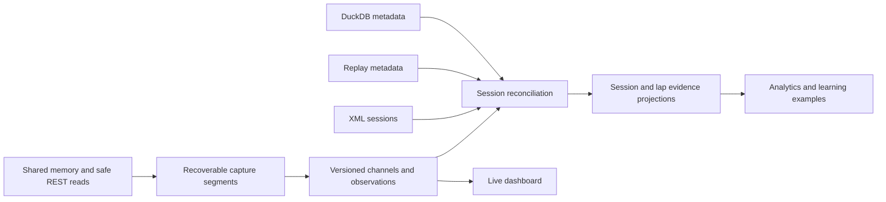

# Live session evidence foundation — implementation record

Archived 2026-10-18: capture, strict reconciliation, aligned reads/chart fusion, disposable diagnostics,
first fuel/VE dataset/baseline evaluation and the three code-review fixes are implemented on
`codex/live-session-evidence`. This archives the delivered code milestone and its original design;
it does not claim that every longer-term requirement below was implemented or validated in a live game.
This is a historical record; its implementation status and correction policy are superseded by the
[live capture reference](../../LIVE_CAPTURE_FORMAT.md). Remaining validation belongs to the
[active plan](../LIVE_SESSION_EVIDENCE.md).

Status: Capture, reconciliation, aligned evidence API, chart integration and disposable diagnostics coded
on `codex/live-session-evidence`, reviewed 2026-10-18. Automated checks pass; real-game validation is pending.
Fuel/VE learning-event capture, compact dataset extraction and chronological baseline evaluation are
also coded. Historical calibration/corrections remain unimplemented and disabled.
Reviewed: Source, 199 native DuckDB catalogs, saved memory/REST recordings and synthetic integration tests.
Scope: Persist live data as a fourth source alongside XML, replay and native telemetry; reconcile it to sessions;
derive traceable evidence for analytics and deterministic learning.
Dependencies: Existing live reader and replay-safe REST polling, normalized session storage, canonical
layout/vehicle definitions, replay reconciliation, and multi-file DuckDB ownership.
Next step: Collect eligible new sessions, inspect the baseline report, then evaluate a bounded historical
correction candidate before enabling corrections. Real-game capture/linking/performance validation is
a separate outstanding acceptance gate. The old dashboard-only SQLite audit remains a separate follow-up.
Completion gate: Recoverable, versioned captures attach only to verified sessions, retain channel-level
provenance, and produce deduplicated learning examples with chronological validation.

## Implementation status — 2026-10-18

### Delivery checkpoint

| Area | Current state | Remaining work |
|---|---|---|
| Automatic capture | Coded; independent of dashboard subscribers; one player-only DuckDB per attempt | Real LMU lifecycle and performance validation |
| Channel normalization | Six verified ISO 8855 vehicle-vector channels plus sparse REST/scoring evidence | 24 wheel columns stay NULL until their conventions are verified |
| Session attachment | SQLite source index, strict XML reconciliation, patch inheritance, missing-file handling | Validate real race-weekend links/restarts/swaps; do not relax ambiguous matching |
| Read/analysis path | Bounded off-track evidence workers, lap alignment, yaw/body-slip chart enrichment | Broader resource/tyre/weather/stop projections are not built |
| Diagnostics | Disposable JSONL sidecars, post-session tail, deferred gzip, manual cleanup | Real-session storage/overhead measurements; no cleanup UI |
| Existing strategy audit | Still SQLite, dashboard-dependent, with frozen forecasts/comparisons and CSV export | Consolidation is not coded; user permits dropping the few old audit runs when replaced |
| Learning dataset | First fuel/VE scope coded and tested | Collect eligible new captures; broader learning targets remain deferred |
| Historical calibration | Not coded | Fit/evaluate a correction candidate, promotion gates, bounded activation and fallback |

Current live fuel/VE estimates still use the arithmetic mean of up to the last three representative
laps, with game estimates as fallback (`shared/domain/live/liveUsage.ts`, `liveStrategyTracker.ts`).
Saving capture data now also supplies frozen fuel/VE forecasts and independent measured outcomes for
off-track dataset extraction; it does not fit or activate a historical correction model. Diagnostic sidecars are
disposable debugging context and must not be the sole source for future learning labels.

Implementation commits: `e51cfa06` capture/reconciliation, `f1cc462a` aligned reader,
`092dae1d` chart fusion, `c2936099` source labels, `0c6e2247` fixture correction,
`1e9b6b27` evidence documentation, `5039f785` diagnostics and `a57d2561` diagnostic documentation.
Learning milestone: `d946e593` frozen resource evidence and `bf43434d` dataset/baseline evaluation.
These are local branch commits; no merge, push or deployment is recorded by this plan.

The user authorized implementation after channel review. The first milestone records player evidence
independently of dashboard subscribers, in `server/live-captures/` (override `LMU_LIVE_CAPTURE_DIR`).
Each session attempt has a readable layout/kind/time/UUID filename ending `.live.duckdb`. Native
telemetry files are neither rewritten nor mixed into this catalog. No quota or automatic deletion applies.

`server/live/capture/` owns ISO decoding, channel metadata, sparse REST selection, bounded transport,
worker writes and XML reconciliation. Six verified vehicle velocity/angular-rate values are stored at
the reader's approximately 50 Hz cadence. The 24 reserved wheel columns remain SQL NULL and have
`verified=false`: recorded nonzero values alone do not establish their ISO wheel frame/sign mapping.
The proper rotation is `(forward,left,up)=(-nativeZ,-nativeX,nativeY)` for both vehicle vectors.
Saved JSONL supplied real numeric regression inputs; it is rounded decoded evidence, not a raw ABI dump.

Sparse observations retain player scoring/conditions, car damage/compound state, selected pit menu,
resource choices, tyre inventory/estimates, repair/refuel estimates, forecast and schedule, plus
versioned deterministic strategy predictions. Safe existing REST requests supply these observations;
request intervals are retained separately from game elapsed/lap clocks. Opponent records are excluded.

The SQLite index survives manual file deletion. Matching requires a known canonical layout and vehicle,
exact driver, session kind, bounded timestamps, at least two completed lap anchors within 0.05 seconds,
and a unique one-to-one candidate. Conflicting anchors prevent attachment. XML `GameVersion` is inherited
only after verification; ambiguous evidence stays pending and stale links are withdrawn. Raw-file
provenance is synchronized while off track. Session detail exposes `liveCaptures`; `/api/live/capture`
exposes recorder health, queue/drop counts and channel availability.

Writing uses transferred typed batches, a bounded queue and one dedicated worker; overload produces
explicit drop counts. Finalization checkpoints DuckDB off track. Reconnect reuse requires a unique recent
identity/clock/lap-anchor match; completed attempts cannot reopen. Replay or inconclusive navigation
does not release capture frames. Startup can therefore leave an intentional gap until live play is confirmed.
Catalog discovery validates app signatures; native DuckDB files are ignored. Shutdown waits for writer exit.
Existing source controls and folder help now call LMU's exported data **Native telemetry**;
internal `duckdb` API identifiers remain compatible with existing consumers.

Validation includes real worker writes/readback, retry idempotency, recovery, bounded backpressure,
catalog rediscovery, strict reconciliation, REST selection and replay exclusion. A synthetic hour
(180,000 rows, six varying doubles plus 24 NULL channels, no REST stream) occupied 17,575,936 bytes
after checkpoint. Writer throughput was 81.97 seconds for that hour, with 18.86 ms median / 39.15 ms
p95 per 50-row batch. These are storage/throughput measurements, **not measured game frame-time impact**.

Checks passed: 3,118 tests (56 intentionally skipped), production build, final recorder/API tests (63),
source-label/settings tests (174) and the endpoint benchmark. The source-label detector found no issues.

Still planned: wheel convention verification, visible source management, broader learning targets,
real-session baseline evaluation and forecast calibration.
The sections below retain the broader design; proposed examples are not all shipped interfaces.

## Code review corrections — 2026-10-18

Three reproduced boundary failures were corrected. When a recent interrupted capture otherwise matches
but the exact layout is still unresolved, initialization waits for navigation instead of immediately
forking a second recording. The initial identity/lap-anchor/time proof is retained while waiting, so a
line crossing before resolution does not defeat recovery. A clock reset, changed identity or departure
from the session clears that provisional proof; a different resolved layout cannot reuse the old file.
No samples are persisted during this wait; the missing interval remains a coverage gap.

Controller and writer now share constants for the transport envelope: four normal outstanding batches
plus two initialization/finalization slots. Numeric and observation-only batches use the same bounded
six-batch writer FIFO; link/catalog maintenance commands retain a separate two-command limit. Sparse
weather/condition/learning observations therefore cannot unexpectedly hit a smaller two-batch queue
and disable the recording. A real-worker regression verifies six accepted batches and rejected overflow.

The aligned evidence service re-reads the exact requested driver/lap ordinal after the worker returns,
checking lap number, duration, player flag and driver/vehicle identities as well as current source
ownership. XML reparses that insert/remove/reassign lap ordinals or exchange player driver ordinals
return `changed` instead of attaching old evidence to the new locator. The full regression suite passed
3,182 tests (56 intentionally skipped); real-game performance validation remains outstanding.

## Disposable race diagnostics — 2026-10-18

Implemented separately from permanent DuckDB evidence. Each recording activation creates an adjacent
`<recording-stem>.<diagnostic-UUID>.diagnostics.jsonl` sidecar; the first record names its recording ID
and DuckDB filename. A recovered recording gets another diagnostic segment rather than overwriting a
previous file. Capture runs without dashboard subscribers. Disable only diagnostics with
`LMU_LIVE_DIAGNOSTICS=0`; `LMU_LIVE_CAPTURE_DIR` controls both recording and sidecar location.

Existing pit-poller requests and the shared-memory reader's navigation probes emit endpoint, wall-clock
start/end/duration, HTTP status, timeout/abort/connection outcome, available OS error code, parser result
and applied/ignored/stale disposition. Failed HTTP/JSON/partial transport bodies retain an 8,192-character
excerpt. Successful parsed bodies retain up to 32,768 characters, with explicit truncation. Standings
responses are reduced to the player before logging; opponent rows are excluded. No extra REST polling
is introduced. Independent identity-resolver requests are not transport-logged; resolved identity changes
are recorded in app state. This is bounded diagnostic evidence, not a lossless network trace.

Successful unchanged responses are deduplicated by endpoint/outcome/body, ignoring request timing;
one-minute checkpoints retain timing and a suppressed-response count. Every failure, parser rejection
and stale response is retained subject to bounded buffering. State/navigation/loading/process changes,
session manifests and endings, capture health/drop counts, writer/reader failures and ten-second strategy
snapshots (model version, game elapsed time and tracker observations) provide application context.
Strategy snapshots also occur on lifecycle transitions. Diagnostic forecasts are debugging context;
they are not frozen learning labels or a replacement for the existing strategy audit.

Requests bind to their original recording when issued, so late responses remain in that sidecar even
after the poller discards them. Reader probe events route by request start time. A two-minute tail after
session end retains existing post-race/menu probes and transitions; no new polling is started for the tail.
Nothing is logged before the first recording or after its tail expires. A new session receives its own file.

Writes use asynchronous streams with at most 256 KiB of queued/in-flight string bytes per sidecar;
overflow increments explicit dropped-record counts. Successful responses/configuration changes are
serialized at existing poll frequency, never per telemetry sample. After the tail, gzip runs asynchronously
only once no newer capture is active; it writes a temporary output, renames it on completion, then removes
the original JSONL. Shutdown drains recording writes and diagnostics. An abrupt exit can leave readable
uncompressed JSONL; compression failure preserves the original (and may leave a temporary output).
An already-running gzip job is not cancelled if a new session begins; real game overhead remains unmeasured.

Retention is manual: keep the last couple of race weekends as useful, then delete only
`*.diagnostics.jsonl.gz` (or closed crash-left `*.diagnostics.jsonl` / `*.diagnostics.jsonl.gz.tmp`).
Use the file browser's size column to inspect usage. No automatic age/size deletion, storage quota,
cleanup API or cleanup UI is added. Removing these sidecars does not alter DuckDB evidence, SQLite
session links, learning inputs, or the old manually collected `C:\Documents\lmu-live-captures` folder.
Never delete active JSONL files. Storage varies with response changes/failures; no fixed weekend-size
claim or zero-overhead guarantee is made. Tests cover dedup/checkpoints, failures, gzip readback,
overflow reporting, original-session ownership and deferring compression during a newer active capture.
Validation passed: full suite 3,151 tests (56 intentionally skipped), production build, then 14 focused
request/shutdown regression tests and TypeScript checking after the final bounded-close changes.

## First learning milestone — 2026-10-18

Implemented fuel/VE dataset construction and offline baseline evaluation; no historical correction
parameters are fitted or used by the live planner. `LiveLearningCapture` emits version-1 compact
`learning-forecast` and `learning-outcome` observations into the session DuckDB through the existing
bounded writer. It operates without dashboard clients, SQLite audit checkpoints or diagnostic sidecars.

Forecasts freeze each resource's actual live estimator output once, within two seconds of the lap
start, retaining model version, measured/game source, compound and wet/dry context. Fuel and VE freeze
separately, even if one is unavailable. Later `LiveUsageMeter` observations supply independent crossing
consumption outcomes, separately deduplicated for asynchronous fuel/VE arrival. Joining mid-lap never
manufactures an earlier forecast. Context changes, pits, caution/start phases, invalid lap flags,
significant damage, resource increases and scoring gaps over two game seconds leave exclusion evidence.
Recent context/dedup state is bounded; measurements arriving over two laps late are ignored.

After XML reconciliation, `server/live/learning/service.ts` processes at most four sources per refresh,
serially and only off track. It waits until the recording writer's worker has exited before opening
another DuckDB handle. A dedicated reader worker opens finalized/verified recordings through the same
signature/convention gate as the chart reader; it selects learning observations only, not telemetry
frames. Reads reject unsupported/corrupt learning events and exceedance of 40,000 events or 16 MB of
JSON; workers have a 30-second timeout. No new job starts while a game session is loaded; a session
loading during an existing read causes its result to be discarded. In-flight reads are not cancelled,
so these workload limits do not establish measured zero game overhead.

`buildLearningExamples` produces one row per physical session/driver/lap/resource. It requires unique
forecast/outcome evidence, canonical stored clean/representative XML flags, completed non-start laps,
matching start/duration/crossing clocks (0.05-second tolerance), known layout/car/XML patch/compound,
valid frozen predictions and consistent conditions. Any recorder drop conservatively excludes that
recording's examples. Duplicate observations, missing forecasts and other failures remain explicit
exclusions. Only measured accepted meter outcomes produce rows; unsupported or unmeasured laps do
not acquire invented labels. Captures predating these events yield zero examples; there is no backfill
of retrospective forecasts from old snapshots or diagnostic responses.

SQLite stores only the compact rebuildable `live_learning_examples` projection and
`live_learning_sources` signatures/status/errors, not duplicate raw recordings. Transactional replacement
and a physical-lap/resource primary key prevent repeated ingestion from multiplying examples. Signatures
include current attachment revision, manifest and canonical lap eligibility/timing/conditions. Readers
recheck those inputs before evaluation; XML reparses, ambiguity or link withdrawals exclude stale data.
Unchanged valid compact facts survive manual raw-file deletion. If XML changes after raw deletion,
stale facts remain stored but are excluded because they cannot be safely rebuilt. Read failures retain
their error and retry after a one-minute backoff. Existing SQLite strategy audit/CSV writes remain;
replacing that separate path and dropping its few historical runs has not been done.

Run `npm run learning:evaluate` for the default `server/lmu_cache.db`, or
`npm run learning:evaluate -- <sqlite-path> <holdout-fraction>` (default 0.25). The CLI is read-only:
it does not start REST requests, scan recordings or initialize a database. Start the updated app to
initialize tables and build projections; the command reports `not-initialized` for an older database.
An empty/new dataset reports `awaiting-eligible-evidence`. Current eligible examples are split by whole
session in chronological order; equal start timestamps stay on the same side of the split. With too
few distinct session start times, test counts stay zero; zero-count metrics are not evidence of accuracy.

The report gives separate fuel (L/lap) and VE (percentage-points/lap) metrics: count, signed bias,
MAE, nearest-rank p95 absolute error and underprediction count. Error is predicted minus actual;
negative means underprediction. Exact cohorts include layout, vehicle, driver, XML patch, conditions,
compound, prediction model and measured/game source; compatible training counts identify sparse or
previously unseen cohorts. It reports exclusion counts and source failures and explicitly states
`historicalCorrectionsEnabled=false`. It measures the existing frozen live estimator; no alternative
model, confidence calibration, promotion gate, correction rollout or learning dashboard is implemented.

Verification covers immutable independent forecasts/outcomes, no-dashboard persistence, asynchronous
measurements, exclusion evidence, real DuckDB worker readback, stale ownership/classification races,
retry recovery, idempotent compact projections, raw-file cleanup and chronological split/unit integrity.
Final checks passed: 3,176 tests (56 intentionally skipped), production build and TypeScript checking.
A read-only CLI smoke check against an initialized empty SQLite fixture returned
`awaiting-eligible-evidence` and left the database bytes unchanged; the existing local database returned
`not-initialized` until the updated app initializes its schema. No personal data was rewritten for validation.
Real-session capture overhead, useful sample yield and held-out prediction accuracy remain unmeasured.

## Aligned evidence reader — 2026-10-18

`GET /api/session/:sessionId/live-evidence?driverOrdinal=0&lapOrdinal=1` uses the same stored
session/driver/lap ordinal locator as native telemetry and replay requests. `src/api/liveEvidenceApi.ts`
provides the typed frontend fetcher. This exposes a complementary source; it does not replace native
telemetry or replay measurements or silently overlay them on existing charts.

The service requires the player, a completed XML lap, one current verified attachment and a unique
matching scoring lap-start/duration anchor (0.05-second tolerance). It reuses the canonical reconciliation
rules against current XML before and after the worker read. Withdrawn ownership, reparsed identity/timing,
missing files, ambiguous matches and loaded game sessions return structured `state: unavailable` reasons.
Missing or invalid locators return HTTP 404 or 400. Responses use `Cache-Control: no-store`.

`evidenceReader.ts` permits at most two independent read-only workers, with a ten-second timeout.
They never use the writer queue, and their process-local DuckDB handles are released before responses
resolve. The reader validates file identity, schema, normalization, channel conventions and stored anchors.
It reads at most 50,000 raw samples per lap; exceeding that limit reports unavailable rather than silently
downsampling. No read starts while a game session is loaded; a session loading during a read discards
its result. This is workload avoidance, not a measured guarantee of zero game-performance impact.

Samples retain game elapsed seconds and derive `lapSeconds = elapsedSeconds - verifiedStartSeconds`.
The raw memory lap counter is not assumed to have the XML numbering. Values remain ISO 8855 float64
measurements; unavailable entries remain NULL. Coverage includes first/last lap timestamps, gaps over
0.1 seconds and the recording-wide drop count. There is no interpolation, time stretching, nearest-lap
selection or change of source ownership. Native track/map coordinates remain untouched.

Only game-timestamped observations within the lap enter `observations`. REST observations without a
game timestamp remain in `sessionObservations`, retaining request/wall timestamps without assigning
them to a lap. Each stream is bounded to 1,000 observations and 1 MB of JSON data before transfer from
the worker; `observationsTruncated` signals omitted data. Recording ID plus sample index / observation
ID provides stable deduplication identity, including observations at a shared lap boundary.

Verification: the full suite passed 3,126 tests (56 intentionally skipped); subsequent focused reader,
API and benchmark tests passed 19 tests, including JSON bounds and concurrent-reader rejection.
The production build passed without warnings. Real worker tests cover exact lap intervals, zero/NULL
preservation, gaps, session-only REST evidence, stale identity/clocks, path traversal and manual deletion.
The before/after endpoint sweep on the same snapshot found no regression above the project's
>20% and >5 ms threshold. The unlinked evidence path measured 1.29 ms median / 2.39 ms p95;
that number does not represent a real-file read or game frame-time overhead.
This chart reader does not extract training examples; the separate learning worker above does.
Neither path calibrates forecasts or enables unverified wheel data.

## Chart and analysis integration — 2026-10-18

Player telemetry responses now include an inexpensive `hasLiveCapture` hint only for an available
verified attachment under the current match rule. `fetchSessionTelemetry` requests the separate
evidence API only when that hint is present. Missing/unavailable supplemental evidence leaves the
base trajectory usable and reports an unavailable source state; cancellation still propagates.
The same fetch path serves primary/comparison laps, debriefs and consistency analysis.

`shared/domain/live/liveTelemetryFusion.ts` requires exact session/driver/lap identity, matching
completed lap durations and ISO conventions. Native telemetry uses its explicit lap-relative clock.
A session-relative replay requires an explicit lap origin agreeing with the live game-time anchor
within 25 ms; matching uses the shared game clock, not an arbitrary first-point offset. Unknown
clocks remain unaligned. No time fitting, sample stretching, interpolation or extrapolation is applied.
Each target chart point selects its nearest source sample within 25 ms and within the recorded span.
Capture gaps, unavailable values and low/reverse forward velocity retain the computed fallback.

Measured yaw rate converts rad/s to deg/s without rounding. Body slip is derived as
`atan2(velocity_left, velocity_forward)` for forward velocity at least 5 m/s, retaining the ISO
positive-left convention. Per-point `liveDynamics` records the source recording, sample index,
time offset and which dynamics were supplied. Replay coordinates, timing, native input channels,
source identity and stored caches are unchanged.

Client dynamics processing preserves these supplied yaw/slip values and uses the supplied yaw in
subsequent deterministic balance calculations. **Native telemetry G-force measurements remain
unchanged, including measured zeroes; replay-only G remains computed.** Live-derived G is still an
estimate when calculated using yaw and speed, not a direct acceleration measurement. Unverified wheel
channels remain disabled. No forecasting model is trained or recalibrated by this integration.

The inspector shows live coverage as a percentage of served chart points for yaw and beta,
with raw gaps, recording-wide drop counts, patch and normalization provenance in the tooltip.
Following the existing G-force convention, real-data yaw and velocity-derived beta have no extra
channel badge; only estimated fallback shows `COMPUTED` at the selected point. This supersedes the
initial `LIVE CAPTURE` / `LIVE VELOCITY` badges by user direction. Coverage percentages describe
chart-point coverage, not an uninterrupted raw lap.
Comparison traces retain the existing distance-based display interpolation; that is not a new raw
live measurement. Missing captures show a reason without hiding the base telemetry.

Verification: the full suite passed 3,140 tests (56 intentionally skipped), with final focused fusion,
fetch, chart and route checks covering G preservation, cancellation, identity, clocks, gaps and source
disclosure. The production build and mechanical UI detector passed; covered-point, gap and unavailable
states were visually inspected in an isolated synthetic preview without touching LMU or real sessions.
The final focused suite passed 42 tests; a route check also confirms the attachment hint does not
mutate retained trajectory objects. Same-snapshot endpoint sweeps found no threshold regression;
automatic telemetry measured 154.57 → 152.00 ms and VCR telemetry 82.23 → 80.48 ms median.
Those endpoints measure the unlinked path, excluding a live-file read and client fusion.

## 1. Objective and boundaries

### Confirmed user decisions (2026-10-17)

- Record automatically whenever this app and LMU are running, independently of dashboard visibility.
  Persist actual live-session evidence only; menu/replay states still follow the exclusion rules below.
- Capture all verified useful channels not covered by native telemetry and replay. Build a capability
  matrix to establish coverage, units and semantics; do not limit the initial scope to strategy essentials.
- Retain recordings without a hard size cap or automatic oldest-first deletion. The user will perform
  manual cleanup when needed; report recording sizes so usage is visible. This supersedes the initial
  5 GB policy. Compact learning evidence, source manifests and provenance remain separate.
- Use data representations appropriate to each channel and minimize capture CPU, allocations and I/O
  to avoid affecting game performance. Defer compression and expensive compaction until the session ends.
- Store live capture in **one app-owned DuckDB recording per game session attempt**, including multiple
  capture/reconnection segments. Keep it separately linkable and manually removable like native telemetry.
- Name sources by meaning: **Native telemetry** for LMU's exporter and **Live capture** for app-recorded
  supplemental data. DuckDB names the storage engine, not the source category; see section 10.
- Convert verified LMU memory dynamics to the **ISO 8855 standard** once at ingestion, before writing
  the live-capture DuckDB file. The app expects ISO 8855 values; persist those directly so readers,
  fusion and learning do not repeat source-axis/sign conversion. Never label unmapped native values ISO.
- Capture the player car only. Opponent race context comes from saved VCR replays; when no replay
  is saved it is absent. Do not record opponent scoring in live capture.
- The game patch reported by XML `GameVersion` is sufficient game-version provenance. Do not require
  exact executable-build discovery or introduce a separate game-build lookup as a prerequisite.
- Use DuckDB's existing game-time and lap-relative alignment convention as the primary reference
  for live data. VCR is a supporting compatibility example, not the preferred capture model.
  Do not introduce a separate wall-clock alignment system for live channels.
- The user subsequently authorized implementation after reviewing the channel analysis.
- Before implementation, present the concrete channel list, cross-source coverage, verification status,
  and proposed capture shape/cadence for user review. No implementation before channel scope is known
  and reviewed. See [Live channel inventory](../LIVE_CHANNEL_INVENTORY.md).

Treat live observations as durable session evidence, independent of whether the dashboard is open.
The dashboard becomes a consumer of that evidence. XML remains the anchor for official stored
sessions and results; replay and DuckDB remain independent sources with their existing responsibilities.

The first milestone is trustworthy evidence, not automatic forecast calibration. Later learning must
remain deterministic, learn from measured outcomes, and demonstrate improvement against a baseline.
AI may explain findings but must not calculate metrics, source ownership, scores or predictions.

Sections below combine implemented contracts and the longer-term target design. The delivery checkpoint
and implementation sections above state what is coded; broader projection, recovery, compression and
learning requirements below are not claims that those features are already implemented.

## 2. Current ingestion architecture and findings

| Source | Current entry and storage | Consequence for this proposal |
|---|---|---|
| Results XML | `server/core/dbSessionSync.ts` and `server/sessions/parser.ts`; normalized session/driver/lap rows | Creates the official historical session; new source attachments must survive reparses |
| Replay | `server/core/replay/dbReplaySync.ts`, replay workers and stores | Adds trajectory, weather and race evidence; retained cache survives missing source files |
| DuckDB | `server/telemetry/telemetryCatalog.ts`, `duckdbReader.ts`, `telemetryLinks.ts` | Multiple files can belong to one session; ownership and lap file selection are already distinct concerns |
| Live capture | `server/live/capture/`, `server/core/live/dbLiveCaptureStore.ts` | Durable player evidence, strict session links and aligned reads independent of the dashboard |
| Live strategy audit | `LiveAuditTracker`, `live_strategy_audit` | Existing dashboard-dependent frozen forecasts/comparisons; separate from permanent capture and diagnostic sidecars |

Relevant findings:

- XML session IDs currently derive from the XML filename. A live capture cannot know this ID in advance.
- Completed XML paths are skipped on ordinary scans. Attach evidence through reconciliation rather
  than forcing XML reparses or fingerprint checks.
- Session writes and summary projections are transactional. Source attachment and resulting projection
  changes must also be atomic.
- Scans are held while a game session is loaded; live persistence must operate independently of that hold.
- `LiveService` owns the reader worker. Capture keeps safe REST polling running without dashboard
  clients; the old SQLite audit still depends on clients and can end when the page disconnects.
- `LiveAuditTracker` records snapshots at bounded checkpoints, including immutable forecasts and
  measured consumption comparisons. It is useful forecast evidence, not a complete source recording.
- `dbLiveAuditStore.ts` stores JSON checkpoints and prunes to the newest 30 runs at startup. That policy
  cannot govern the long-term learning dataset.
- Capture manifests retain exact source driver name, canonical layout/vehicle, verified XML patch
  provenance and channel declarations. They do not establish a globally unique person or swap ownership.
- Scoring decoding now preserves `driverName`. A game vehicle slot is not a persistent driver identifier.
- XML `GameVersion` is parsed and persisted as `sessions.game_version`. The live contracts do not
  establish an exact game build. Shared-memory update counters are frame-coherence counters.
- Existing telemetry fusion implements explicit DuckDB/replay field precedence, but does not offer
  general channel/interval provenance for a fourth source.
- The current source paths do not automatically calibrate forecasts from saved audits or establish
  an inferred historical session link for those audits.

## 3. Target data flow

Add this incrementally. Do not replace the existing source stores or introduce a generic ingestion
framework before the live-source contracts and consumers justify it.

## 4. Capture identity and lifecycle

Separate three identities:

1. **Capture:** one recorder run with a stable generated ID and recorder provenance.
2. **Segment:** a continuous interval within one game session attempt and clock epoch.
3. **Session attachment:** a versioned association between a segment and an existing stored session.

The implementation creates a separate recording/file for each practice, qualifying, race or restarted
attempt; it never stores a mixed-session capture. A unique recent interrupted recording may reopen only
after strict identity/clock/lap-anchor continuity checks. Otherwise it creates another provisional file.
General segment tables, fragment consolidation and driver-swap interval ownership remain future design.

Persisted manifest states are `recording`, `completed` and `interrupted`; controller health separately
reports unavailable/errors. Recovery is a validated transition, not a separate persisted `recovered`
state. Preserve late-start and partial coverage; distinguish interruption from session restart.

Persist live evidence immediately without waiting for XML. Keep unmatched captures available for
later reconciliation. Do not invent official historical results when no XML exists.

Recording demand must be independent of SSE subscribers. UI backpressure or browser closure must
not change persisted evidence. Preserve existing replay detection, safety checks, request serialization,
timeouts and backoff. Replay playback must never become new live learning evidence.

## 5. Canonical identity and context

Store original source values alongside resolved values and their resolution evidence/version.

| Group | Required evidence or explicit unknown |
|---|---|
| Circuit | Raw track, venue/course/scene where available; canonical layout key; resolution status |
| Vehicle | Raw vehicle/class; canonical vehicle identity and class; content/upgrade identity when available |
| Participant | Exact reported driver name, player flag, source vehicle slot and driver ownership intervals |
| Session | Raw session code, canonical kind, attempt identity and session-clock epoch |
| Conditions | Compound, wetness/rain, fuel and tyre multipliers, relevant settings and setup identifiers |
| Coverage | First/last observation, gaps, late start, interruption and finish evidence |

Resolve circuits directly with `getCircuitSpecification(...)`; do not add a second layout mapping.
Preserve exact custom venue/course identities and leave ambiguous layouts unresolved. Never mix
layouts or collapse vehicle models into a class-only consumption profile.

Use existing canonical vehicle definitions and mapping functions. If they lack a durable car identifier,
extend that canonical model explicitly rather than creating a live-only alias dictionary.

Driver names remain exact source identities, not proof of a globally unique person. Endurance swaps
require explicit driver ownership intervals. A vehicle slot must not be used as a persistent person key.
Unknown ownership can support car-level evidence but must exclude unsupported driver-specific learning.

## 6. Game, content and pipeline version provenance

Keep these independent:

- Game patch from XML `GameVersion`, already stored as `sessions.game_version`; this is the accepted
  game-version granularity. No exact executable-build identifier is required.
- Track and vehicle content/package versions, when available.
- Shared-memory plugin/protocol identity and version.
- Recorder and decoder versions.
- Channel normalization and identity-resolution versions.
- Session matching/alignment rules and evidence projection versions.
- Prediction model version and training-data lineage.

Each value carries its source, observation time and provenance status: directly observed, inherited
through a verified attachment, or unknown. Preserve disagreements between sources instead of silently
overwriting them. An inherited value must reference the verified link and be revisitable if it changes.

After verified session attachment, reference/inherit that session's XML game patch, retaining its XML
provenance and link revision. Before attachment, or when the XML patch is absent, keep it unknown.
Do not delay live capture while waiting for XML and do not infer the patch from dates or the currently
installed game. XML reparses or link withdrawals must refresh/invalidate inherited patch provenance.

Frame update counters, replay format versions and database engine versions are separate from the
game patch. Discovery may establish available content/setup identifiers, but exact-build discovery
is outside the required scope. Compatibility across XML patch versions must be explicit, not assumed
merely to increase training sample counts.

## 7. Multiple channels and observation semantics

Actual-source analysis (2026-10-17): all 199 available DuckDB files declare the same 58 continuous
channels and 40 events. Wind, brake thickness, vertical G, three tyre-temperature bands and initial
setup are already exported. See [the full catalog and proposed capture scope](../LIVE_CHANNEL_ANALYSIS.md)
before interpreting earlier candidate lists as missing-source claims. The complementary dynamic core
is 30 numeric values at observed ~50 Hz, with 44.64 MB/hour of float64 payload plus timestamps; its
normalization and user review gates remain open. No implementation was performed.

Each recording declares the channels it actually captured. Do not assume all game versions, vehicle
classes, exporters or recording segments provide the same fields.

A channel declaration contains:

- Canonical key and original source field/path.
- Producer: shared-memory scoring, shared-memory telemetry, or the specific safe REST read.
- Unit, scalar/vector/four-wheel shape, coordinate axes and sign convention.
- Declared frequency when available and measured cadence/coverage.
- Timestamp semantics, interpolation/hold policy and maximum permitted age/gap.
- Capability/quality status and decoder/normalization version.

Canonical keys may have multiple producers and recordings. Keep the observations separately even
when a projection chooses one. Preserve four-wheel order FL/FR/RL/RR and LMU Cartesian x/z meters.
Follow ISO 8855 as documented by the existing normalization contract; the standard is authoritative,
not an app-specific choice of axes or signs.

ISO 8855 is mandatory for canonical vehicle/wheel dynamics, consistent with the existing telemetry
contract: vehicle X forward, Y left, Z up, positive-left steering and positive-left yaw. Use the
right-hand rule for angular vectors about the declared axes; distinguish angular velocity from
Euler-angle derivatives. Store explicit units and normalization version plus `signConvention: 'iso8855'`
only for verified canonical values. Apply conversion once at the normalization boundary, not in views
or learning models. Do not silently reuse the existing steering-only conversion for new vector fields.

The selected boundary is ingestion, between decoded LMU readings and persisted live-capture tables:
`LMU memory -> decode -> verified ISO 8855 conversion -> typed DuckDB batch -> direct consumers`.
Store source-field provenance and conversion/schema version in channel/recording metadata rather than
duplicating native and normalized sample arrays. Readers honor the stored convention/version and must
not reapply native-source transformations to ISO data. Normalize the accepted columns once for all
consumers, rather than maintaining separate dashboard and historical conversion formulas. Keep this
small deterministic transform bounded; expensive analysis/compaction remains outside the capture path.

Do not assume shared memory requires every sign to change. Use an identity conversion where a
field already matches the canonical meaning, unit and sign. Recorded forward driving demonstrates
that the raw local-velocity vector is not already ISO-axis ordered: at 133.7125 km/h in third gear,
`localVel` is `[0.4143, 0.2803, -37.139]`, with forward speed on negative native Z rather than positive
ISO X. Conversely, the measured native angular Y component already follows the project's positive-left
yaw sign in the paired heading check; it needs correct axis labeling, not an automatic negation.
Validate these mappings per field/frame and preserve compliant values without a second conversion.

Record source axes/units and the conversion formula for local velocity, angular velocity, wheel contact/
ground velocities, camber and toe. Wheel-local frames require their own documented ISO-compatible
definitions and per-corner sign checks; do not guess a camber/toe sign from left/right corner alone.
If a conversion is not yet verified, exclude that field from canonical capture columns until validated.
Any deliberately retained diagnostic native evidence must have a separate explicit convention/schema;
never mix it into ISO columns or pass it to canonical learning. Native diagnostic duplication is not
the default recording design. Historical diagnostic files used by this analysis remain untouched.

Track/map geometry remains in native LMU Cartesian x/z meters (y up), as required by existing domain
rules. ISO vehicle axes do not authorize rotating, mirroring or relabeling track boundaries/positions.

Separate the meaning of the recorded values:

| Kind | Examples | Learning treatment |
|---|---|---|
| Measurement | Fuel, VE, tread, wetness, damage | Candidate observed evidence with quality/coverage checks |
| Game estimate | Repair-time estimate, forecast, estimated usage | Predictor or estimate to evaluate; not measured truth |
| Selection | MFD target, selected tyres, garage setting | Intent/configuration; not proof of service performed |
| App prediction | Pit window, finish resource, recommended ratio | Immutable forecast with model/input lineage |
| Outcome | Measured lap consumption, actual stop duration | Target only after timing and completeness validation |

Record fuel litres, VE percentage points, fractions and percentages explicitly. Unknown or unsupported
channels remain absent/null, never zero-filled. Documented zeroed force/load channels must not become
valid measured training features without new evidence validating them.

Inventory all verified useful channels against native telemetry and replay, including measured motion,
per-wheel data, condition/tread, damage, weather, forecast and pit-menu/service information. Persist the
useful missing channels from the first capture profile; no strategy-only scope restriction applies.
Coverage means compatible semantics, units, fidelity and usable availability, not merely similar names.
Document whether a channel is redundant, complementary, unavailable, or requires further validation.

Keep the minimal overlapping timing, identity and resource observations needed for verified alignment,
capture integrity and outcome evaluation. Record why each overlap is necessary; do not duplicate full
telemetry/replay streams indiscriminately. Define behavior when an ordinarily covered channel is absent
from the actual recording, without changing the agreed principle of complementary capture.

## 8. Clocks, freshness and alignment

### Reuse the existing DuckDB/replay time convention

`duckdbReader.ts` uses `GPS Time` as the continuous sample timeline when available and timestamped
`Lap` transitions as lap boundaries. It emits lap-relative seconds as `pointTime - startTs`; channel
frequency/insertion order aligns continuous channels without their own timestamps. Timestamped state
changes retain their event times. The reader has a declared-frequency fallback when GPS Time is absent.

DuckDB is the preferred reference for the live timeline and alignment contract. Preserve explicit
native sample times, lap boundaries and channel cadence, then expose the same lap-relative seconds
for comparison. This preference concerns time semantics. The separately confirmed storage choice is
an app-owned DuckDB recording; LMU's native file need not exist or be open during live capture.

VCR provides a supporting compatibility example: frame `sTime` is elapsed simulation-session time,
replay start/end times use session seconds, and timing-loop events carry their session crossing time.
`replayLapPoints.ts` preserves `sTime` as `timeSec`; the trajectory contract supports
`timeReference: 'session'` and `lapStartTimeSec` for the selected lap. Keep interoperability with those
existing contracts while using DuckDB as the primary alignment reference.

Retain explicit clock epochs and native precision for live observations. An absent lap-start anchor
stays unknown; the first captured sample of a partial lap is not its lap start.

`telemetryFusion.ts` aligns replay points to the same lap-relative axis, subtracting the replay's
`lapStartTimeSec` through `vcrLapBaseTime` when the replay clock is session-relative, and respecting
explicit `timeReference: 'lap'`. Reuse these defining implementations directly where applicable; do
not create a pass-through live alignment wrapper or a second implementation of replay time rules.
The existing legacy fallback to the first replay sample is a compatibility path for retained replay
rows without clock metadata, not a convention to reproduce in new live recordings.

Live telemetry already exposes game session elapsed time (`elapsedTime` in `rf2Decode.ts`); scoring
exposes `currentEt` and `lapStartEt`. Preserve those source times and project verified lap intervals onto
the same lap-relative axis. DuckDB need not exist or be open while capturing: alignment to its recorded
timeline happens later, using matched lap/sector boundaries and verified source ownership.

Validate agreement between live elapsed time, DuckDB GPS/event time and replay session time on shared
crossings before assuming a zero offset. Reusing the convention does not prove identical clock epochs
or erase source latency. Persist any supported offset and residual error; keep uncertain overlaps
unresolved. Live samples have explicit source timestamps, so do not replace them with DuckDB's
row-index/frequency fallback or force them to 100 Hz.

UTC/filename times continue to help session ownership reconciliation; they are not the sample-fusion
clock. Monotonic receipt timing is for latency, freshness and recovery diagnostics. REST responses
without a source timestamp remain interval observations rather than falsely precise telemetry samples.

Preserve source game elapsed time, UTC receipt time, monotonic recorder time, source sequence and
segment/epoch ownership. For REST reads, keep request start/end and source time if supplied; receipt
time alone is not the exact measurement time. Declare uncertainty rather than inventing precision.

- Split genuine backward clock resets into new epochs/attempts; handle pauses separately.
- Record missing intervals, reconnects and repeated/stale source frames.
- Do not compute UTC session start solely as receipt time minus game elapsed time: pauses and delay
  can invalidate that calculation.
- Align lap intervals through line crossings, sector timing and session evidence, not lap number alone.
- Persist alignment method/version, offset where justified, residual error and permitted tolerance.
- Keep observations at their actual time. A cached condition response is not a fresh tyre measurement
  on every snapshot or necessarily an exact line-crossing observation.
- Never interpolate across unbounded gaps, session resets, refuelling or incompatible state transitions.

Channels can have different clocks and freshness within the same snapshot. The persistence contract
must retain that distinction rather than treating the assembled dashboard snapshot as simultaneous truth.

## 9. Session reconciliation and source ownership

Reconcile after XML writes, segment finalization/recovery, and relevant replay/DuckDB metadata changes.
Use bounded candidate windows and incremental change stamps, following existing reconciliation patterns.

Evaluate canonical layout, session kind/attempt, exact trusted participant evidence, compatible vehicle,
time overlap, and lap/sector agreement. Inherit the XML game patch only after ownership is verified;
an inherited patch must not be used as circular evidence to establish that same ownership.
Use observed coverage windows, not an assumption that capture start equals session start.

Require an unambiguous owner supported by evidence. Do not choose a nearest-time candidate when
identity or attempt ambiguity remains. Store pending/rejected/linked status, rule version, candidate
evidence and reason codes. Withdraw invalid links and rebuild dependent projections atomically.

Explicitly cover restarted races with shared XML timestamps, same-layout back-to-back sessions,
mid-session joins, empty attempts, driver swaps, missing XML and delayed source discovery. Additional
files or segments must not overwrite an earlier fragment or duplicate its observations.

Use capture IDs and immutable chunk identities, not filenames, as source identity. Re-ingesting the
same evidence must be idempotent. Session, driver and lap locators use stored session IDs and source
ordinals, not recording filenames or assumed globally unique lap numbers.

Reparsing XML restores source attachments. Ordinary attachment must not reread immutable XMLs.
Stored evidence and verified attachments survive deletion of original XML/replay/capture files.

## 10. Persistence and retention design

### Confirmed storage: one live-capture DuckDB file per session

Use one app-owned DuckDB file for each game session attempt. This follows the native telemetry's
file-based discovery, attachment and manual-cleanup pattern while storing complementary evidence.
SQLite remains the session index and owner of links, compact projections and learning metadata;
it is not the selected raw live-recording container. The earlier SQLite-first recommendation is superseded.

Several recorder runs/reconnection segments can contribute to the same file only after continuity of
the session attempt is established. Never split solely because a browser disconnects or the car enters
the garage. Never combine practice/qualifying/race or restarted attempts just because their names or
timestamps agree. Uncertain recovery fragments remain provisional; reconcile and safely consolidate
verified fragments into the session file, retaining segment identities and deduplicating observations.
The one-file rule concerns the canonical recording, not transient recovery/WAL/finalization artifacts.

Create the recording before its XML is available, with an immutable recording/session-attempt ID in
metadata. A readable filename can include canonical layout (when known), session kind, UTC start and
a short recording ID to avoid collisions; for example `bahrain_outer_R_<UTC-start>_<id>.live.duckdb`.
Names help manual browsing but do not establish ownership. Do not require file renames when XML
arrives; store the verified session link in SQLite and in appropriate provenance metadata.

Keep live files in their own configurable directory and never modify LMU's native telemetry files.
Reuse catalog/discovery/linking concepts without routing a different schema through native parsers.
Include source kind and schema version in each file's manifest. Deleting a finalized live file manually
must mark that source unavailable while preserving the session, native telemetry/replay links and
retained compact evidence. Avoid deleting files with an active writer.

Use a dedicated writer worker and bounded, typed bulk batches; no synchronous database work on the
reader/event-loop path and no per-sample transaction. Benchmark batching, memory, flush/checkpoint
behavior and crash recovery. Defer expensive explicit compaction/archive work until the session ends.
DuckDB can perform internal encoding/compression/checkpoint work during writing: do not promise it
is entirely disabled. If direct writing misses the performance gate, review a temporary staging path
without changing the agreed canonical per-session DuckDB output or silently adding a second format.

### Meaningful source naming

| Meaning | Product/domain label | Source discriminator (proposed) |
|---|---|---|
| LMU-exported telemetry recording | Native telemetry | `native-telemetry` |
| App-recorded complementary session evidence | Live capture | `live-capture` |
| Binary replay | Replay | Existing replay identity |
| Official results | Session results | Existing XML identity |

Use **Telemetry recordings** as a shared heading only where both telemetry sources are intended.
Rename existing UI/domain references that use "DuckDB" to mean native telemetry during implementation;
audit API contracts, persisted fields and migrations together. Do not reinterpret a legacy native
`duckdbFilename` as a live capture or collapse both sources into one filename slot. Keep native
multi-file support: only the new canonical live recording is one file per session.
Engine-specific adapters such as `DuckDbReader` can retain DuckDB in their names where it actually
describes the engine. UI source naming is implemented; existing `duckdb` API/persistence identifiers
remain compatible. No broad file/identifier migration or dependency migration was performed.

The project currently uses the legacy `duckdb` Node client. Official documentation marks that client
deprecated and recommends Node Neo, which exposes bulk appending. Evaluate binding support during
format benchmarking; no dependency migration is authorized by this analysis alone. References:
[SQLite WAL and checkpoint behavior](https://www.sqlite.org/wal.html),
[SQLite application file format](https://www.sqlite.org/appfileformat.html),
[Node client status](https://duckdb.org/docs/lts/clients/nodejs/overview),
[bulk insert guidance](https://duckdb.org/docs/lts/data/insert),
[Node Neo appender](https://duckdb.org/docs/lts/clients/node_neo/overview).

Implemented raw tables are `capture_metadata`, `capture_manifest`, `capture_channels`, `capture_samples`,
`capture_observations` and transactional `capture_batches`; SQLite owns the index/attachments.
The following conceptual groups also include future projection/dataset tables:

| Group | Purpose |
|---|---|
| Live captures/segments | Lifecycle, identity, version provenance, coverage and recovery state |
| Channel declarations | Producer, units, shape, capabilities, cadence and normalization |
| Sample chunks/events | Bounded recoverable observations with ordering, integrity and time bounds |
| Session source links | Ownership, participant/interval mapping, rule version and rejection evidence |
| Lap/stint/stop evidence | Compact derived facts with supporting observations and projection lineage |
| Forecast evaluations | Frozen predictions, later outcomes, model version and error measurements |

Use SQLite WAL, modular stores and prepared statements for the index/projections, and transactional
DuckDB batch writes for raw live recordings. High-frequency data belongs in typed tables, not per-frame
snapshot JSON or a duplicate full-session blob.

### Capture representation and performance

Choose representation by channel semantics, avoiding waste before applying compression:

- Dense numeric channels: typed numeric columns, populated through bounded bulk batches.
  Preserve source precision initially; any narrower type or quantization requires measured error bounds.
- Discrete state/settings: timestamped changes plus an initial state per recoverable chunk, rather than
  repeating identical values every sample. Retain repeated responses only when their new observation
  time carries useful freshness or validation evidence.
- Sparse events: compact timestamped event records, with stable event IDs/sequence for deduplication.
- Static metadata/strings: segment or channel dictionaries/manifests, referenced by ID from samples.
- Timing: shared block timelines only for truly synchronous samples; separate clocks/timestamps for
  asynchronous producers. Never manufacture simultaneity to save space.
- Missing/invalid values: explicit validity masks/status, preserving the distinction from measured zero.

DuckDB is the selected container; table layout, batch encoding and explicit post-session compaction
policy still need measurement. Avoid JSON serialization or a database transaction per sample.
Persist only useful complementary channels and the
minimal overlap required by section 7; avoid full-frame dumps, repeated snapshots and unused padding.

During a session, append typed batches through a dedicated bounded writer, batching I/O
and reusing buffers where practical. Keep expensive encoding, indexes, compaction and training off
the shared-memory reader path. Select block size and flush cadence by both I/O cost and acceptable
crash-loss window; do not perform a durability flush per frame. Record backpressure/gaps explicitly.
Preserve existing safe REST request limits rather than increasing polling to fill nominal sample rates.

### Deferred compression and finalization

Current boundary: DuckDB batch writes and off-track checkpoints are implemented; no separate raw
DuckDB archive/compaction job is implemented. Diagnostic sidecars have their own gzip lifecycle described
above. The resumable raw-data compression, disk-space preflight, independent block/index and
replacement-verification requirements below remain future design, not diagnostic gzip guarantees.

When the game session has ended, enqueue compression/compaction of closed chunks in a background
worker. Browser closure, a temporary disconnection or return to the garage does not establish session
completion. Bound concurrency and CPU/I/O usage; suspend or defer jobs if another game session starts.
Interrupted sessions can finalize after recovery establishes that their segments are no longer active.

Use lossless compression by default. Retain channel metadata, sample ordering, validity, timestamps and
random lap/window access through independent blocks or an index. Verify decompressed content/integrity
before atomically publishing the replacement and deleting the uncompressed input. Keep jobs resumable
and idempotent; on failure the original remains readable. Compression must not change source identity,
observations, projection lineage or classification, and must not require decoding replay files again.

Account for uncompressed and compressed files plus temporary replacement space in storage reporting.
Check available disk space before compression; use bounded-chunk replacement or defer the job when
space is insufficient. Never delete retained recordings automatically to make room, or delete an
in-flight source chunk. Removing verified redundant uncompressed inputs after lossless replacement
is format finalization, not retention cleanup.

Before choosing chunk encoding, measure representative session size, capture overhead, write latency,
recovery and bounded lap reads. Container choice is settled; validate the schema and writer strategy.
Use bounded buffering and an explicit durable acknowledgement/recovery policy. On storage failure,
surface capture degradation and mark gaps; never block the game reader indefinitely or silently
claim complete evidence. Handle disk-full, process termination and incomplete final chunks.

Retention separates raw samples, compact observations/outcomes, and disposable UI/audit diagnostics.
There is no automatic storage limit or age/size eviction for recordings. Retain completed, partial and
unmatched recordings until the user manually cleans them up. Continue bounded buffering/chunking
for memory and recovery; removing the disk cap does not remove those requirements. Measure/report
raw, compressed, temporary and compact-evidence growth separately. Cleanup must preserve compact
learning facts, source manifests and provenance, marking removed inputs unavailable. Do not let the
existing 30-audit-run pruning delete training
lineage. If raw evidence is deliberately removed, retain its manifest and mark
which projections can no longer be recomputed; never claim full reproducibility without the inputs.

The user permits discarding the few existing SQLite audit runs when that audit path is replaced.
No deletion or replacement has occurred; current audit writes/reads/CSV exports remain operational.
Existing audit rows cannot be upgraded into complete
channel recordings or assigned drivers that were never captured. A game patch may be inherited from
a verified XML attachment with explicit provenance, not guessed from the audit date. Migrate only facts their
stored evidence supports; ambiguous historical attachments remain unresolved.

## 11. Session augmentation and source precedence

Raw source observations remain independent. Session APIs consume compact evidence projections
rather than hydrating all live frames into `DetailedSession` or list endpoints.

Select sources per channel and covered interval, using declared quality/freshness rules:

- XML supplies official results and the existing canonical lap classification.
- DuckDB supplies available native recorded telemetry.
- Replay supplies trajectory, traffic and replay-specific evidence.
- Live supplies additional measurements, condition observations and pit/forecast context.

There is no universal "live wins" precedence. A valid DuckDB fuel trace may outrank sparse live reads;
a live-only measured channel can fill a genuinely unsupported channel. Preserve conflicts and the
chosen source, normalization, alignment and derivation in the projection's provenance.

Do not double-count the same physical lap because live, replay and DuckDB observed it. Never replace
missing values with zeros or smooth away a real refuelling/impact transition.

Any use of live rain to change historical lap conditions must enter `classifySessionLaps` and the
canonical annotation path. Do not add a second classifier in views or learning code. Rule changes
require the appropriate parser/projection version and rebuild from retained facts, including sessions
whose XML is gone. Preserve canonical start/in/out/partial lap rules and clean-lap-only pace metrics.

Expose compact source availability, coverage, unresolved status and provenance for inspection.
Invalidate only affected session/lap projections through existing revision mechanisms.

## 12. Learning dataset and deterministic calibration

Status: Fuel/VE examples and offline baseline evaluation are implemented as described in the first
learning milestone above. Dedicated immutable forecast/outcome events operate independently of
diagnostic retention and dashboard visibility; ten-second strategy snapshots are not used as frozen
learning forecasts. Old-audit replacement and historical correction fitting/promotion remain pending.
The broader dataset targets and calibration requirements below are future work.

Produce one example per physical lap, stint or stop, with:

- Session/driver/lap ordinals, stint/stop identity and supporting source/segment/chunk references.
- Canonical layout and car, participant ownership, game/content versions and relevant settings.
- Compound, conditions, fuel load, tyre age, traffic, caution and damage context when supported.
- Coverage, freshness, alignment uncertainty, sample count and exclusion reasons.
- Features actually available at prediction time and the later independently observed outcome.
- Prediction/model version, evidence projection version and training-data lineage.

Use canonical clean-lap eligibility for pace/consumption targets, with additional target-specific
exclusions for pits, cautions, refuelling, gaps and unresolved identity. Pit-stop models use valid stop
intervals rather than incorrectly requiring stops to be clean flying laps.

Candidate learning order:

1. Persistent compatible fuel/VE usage profiles and measured forecast bias.
2. Finish-resource and pit-window evaluation, separating consumption error from race-horizon error.
3. Actual pit-lane/stationary/service outcomes against estimates and selections.
4. Stint-aware tyre/pace models accounting for fuel, traffic, weather and damage where measured.
5. Weather-change forecast evaluation against observed change intervals.

Compare the existing last-three-lap estimator with deterministic alternatives such as recency weighting
and bounded bias correction. Choose parameters from held-out evidence, not intuition alone. Do not
learn labels from the app's own predictions or treat game estimates as measured outcomes.

Evaluate chronologically with whole sessions held out, preventing adjacent laps/source duplicates
from leaking between training and validation. Report sample counts, signed bias, absolute/tail errors,
under-fuelling or missed-stop outcomes, and uncertainty coverage by compatible cohort. Use explicit
fallbacks when evidence is sparse or a new XML patch/context is incompatible.

Promotion requires documented improvement against the current baseline without unacceptable safety
margin regressions, versioned parameters, bounded correction and a rollback path. Confidence/sample
count/source-age readouts should reflect validated evidence, not a decorative confidence score.

## 13. Delivery phases and acceptance gates

| Phase | State | Deliverable / remaining acceptance gate |
|---|---|---|
| 0. Capability review | Done | User reviewed channels; unverified wheel conventions remain explicit |
| 1. Contracts | Coded for current scope | Capture/channel/version/link contracts; broader segment/projection contracts deferred |
| 2. Durable capture | Coded and automatically tested | Live-game overhead/lifecycle and failure validation still pending |
| 3. Reconciliation | Coded and automatically tested | Strict ambiguity/restart/layout/driver rules; real-weekend validation pending |
| 4. Augmentation | Partial | Aligned API, source metadata and yaw/body-slip enrichment coded; resource/tyre/weather/stop projections remain |
| 5. Dataset | First fuel/VE scope coded and tested | Immutable forecasts/outcomes, deduplication, lineage, exclusions, chronological CLI report; real sample yield/evaluation pending |
| 6. Calibration | Not started | Compatible cohorts, held-out improvement, bounded corrections, fallback/versioning/rollback |

The first end-to-end milestone is phases 0-4: a trustworthy session-linked live evidence layer covering
the verified useful channels missing from telemetry/replay. Unverified channels remain explicitly pending;
advanced learning models are not prerequisites for this evidence milestone.

## 14. Verification and repository integration

Add focused tests mirroring source locations for capture stores/recovery, decoding/provenance,
reconciliation, alignment, source selection, projections and learning eligibility. Required scenarios:

- Dashboard absent/closed; multiple viewers; slow SSE client; server restart during a lap.
- Replay entered from a session monitor; replay exit; safe REST timeouts/backoff unchanged.
- Pauses, late starts, clock resets, missing crossings, stale REST responses and long gaps.
- Same facility/different layouts, back-to-back attempts, reused filenames, exact driver ambiguity/swaps.
- Several live segments and DuckDB files covering one session, overlapping channels and duplicates.
- Delayed/missing/deleted XML or replay; reparse and rule-version repair without loss of attachments.
- Unknown XML patches, patch inheritance after verified matching and invalidation after relinking/reparse;
  varying channel availability, unit/sign/four-wheel normalization.
- Refuel, tyre replacement, caution, damage, wet/dry change and incomplete stop outcomes.
- Immutable pre-outcome forecasts, chronological session holdouts and training-data retention.
- Interrupted writes, disk-full, recovery, idempotent re-ingestion and bounded memory.
- Typed representation round trips, state-change reconstruction, timestamp/validity preservation and
  independently readable chunks; any precision reduction has explicit domain error bounds.
- Deferred compression pauses for a new session, survives interruption, verifies before replacement,
  preserves random window reads and checks temporary replacement space without automatic data eviction.
- Automatic capture with no dashboard; complementary channel selection against actual source capabilities.
- No automatic age/size deletion of completed, partial or unmatched recordings; manual cleanup preserves
  compact evidence/manifests and removed raw inputs are marked unavailable.

For implementation, run `npm test` and `npm run build` with zero warnings/errors. Run coverage where
required without lowering thresholds. For API performance changes, run `npm run benchmark:endpoints`
before and after on a fixed cohort; add capture overhead, storage growth, recovery and lap-read
measurements. Live-game safety/performance checks need separate recorded evidence.
Compare recording off/on on the same representative driving workload: game frame-time median/p95/p99
and stutter counts, reader/writer CPU and memory, allocations, queue depth, dropped samples, disk
bandwidth and write latency. Establish numeric overhead limits from the measured baseline before
acceptance; a lower average file size is insufficient if recording causes frame-time spikes. Measure
post-session compression time, peak temporary space, CPU/I/O and interruption/resume behavior separately.

Keep new contracts in `shared/types/`, deterministic algorithms in focused `shared/domain/` modules,
and stores in semantic `server/core/` subdirectories. Respect file/directory limits and direct imports.
Keep domain rewrites out of schema initialization; use versioned reconciliation/projection rebuilds.

Update `docs/CODE_MAP.md` only as behavior ships, and update `docs/TELEMETRY_FORMAT.md`,
`docs/XML_FORMAT.md` and relevant live-source documentation when their contracts actually change.
Use the delivery checkpoint and phase status table for implementation status; design requirements alone
are not evidence that a feature has shipped or passed real-game validation.

## 15. Remaining decisions and validation

1. Collect eligible new fuel/VE forecasts/outcomes and multiple distinct chronological sessions; review
   exclusion rates, baseline error and compatible cohort counts before choosing a correction candidate.
2. Replace or retire the dashboard-dependent SQLite audit/CSV path if consolidation is pursued.
   Old audit history can be dropped; the new permanent learning events already retain independent
   frozen forecast semantics and do not depend on diagnostic retention.
3. Define compatible layout/car/conditions/patch cohorts, chronological holdouts, minimum evidence and
   promotion/error gates before selecting or enabling a correction model. Robust median/shrinkage or
   bounded bias corrections are candidates, not an algorithm already selected or coded.
4. Validate real-session capture/linking, clock tolerances, restarts/swaps, capture/diagnostic size,
   game frame-time and writer/backpressure behavior. Synthetic measurements do not close this gate.
5. Verify wheel frames/signs before enabling their 24 reserved columns; this does not block fuel/VE work.
6. Source-management/cleanup UI, broader evidence projections, extended content/setup provenance,
   swap ownership intervals and advanced raw compaction remain follow-ups; none is claimed complete.

Container choice, ISO convention, reviewed initial channel scope, XML patch source, clock convention
and manual retention are settled. They do not need to be reopened before learning-pipeline work.

## Source references

- [Code map](../../CODE_MAP.md), [telemetry format](../../TELEMETRY_FORMAT.md),
  [XML format](../../XML_FORMAT.md), [VCR format](../../VCR_FORMAT.md).
- [Live dashboard plan](../LIVE_RACE_DASHBOARD.md) and [live sources](../LIVE_DATA_SOURCES.md).
- [XML sync](../../../server/core/dbSessionSync.ts), [parser](../../../server/sessions/parser.ts),
  [session row fields](../../../server/core/sessionRows/specs.ts).
- [DuckDB catalog](../../../server/telemetry/telemetryCatalog.ts),
  [ownership](../../../server/telemetry/telemetryLinks.ts),
  [metadata contracts](../../../server/telemetry/telemetryMatcher.ts),
  [fusion](../../../server/telemetry/telemetryFusion.ts).
- [Replay matching](../../../server/sessions/replayMatching.ts),
  [canonical classification](../../../server/sessions/sessionLapClassification.ts).
- [Live service](../../../server/live/liveService.ts), [reader](../../../server/live/liveReader.ts),
  [layout](../../../server/live/rf2Layout.ts), [decoder](../../../server/live/rf2Decode.ts).
- [Live identity](../../../shared/domain/live/liveIdentity.ts),
  [audit tracker](../../../shared/domain/live/liveAudit.ts),
  [audit contracts](../../../shared/types/liveAudit.ts),
  [current audit storage](../../LIVE_CAPTURE_FORMAT.md#consolidated-strategy-audit)
  (the former SQLite audit store was subsequently removed with user approval).
