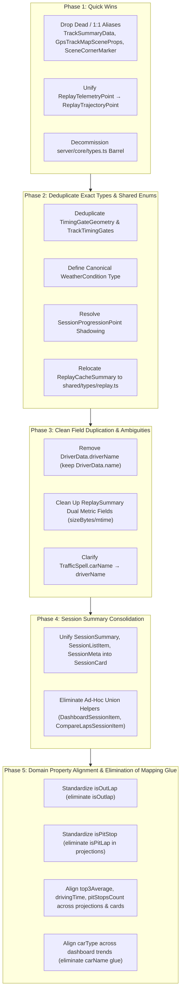

# 🏎️ TypeScript Type Refactoring & Simplification Plan

**Status: Completed 2026-10-12.** Phases 1–7 are on main (`7cc9717c`, `bfa88743`, `33ae4f10`). The real cache
was rewritten offline by `rewrite-db-names.cjs` (kept outside the repo, with a pre-rewrite backup) and the app was
checked against it. `test/domain/retiredNames.test.ts` keeps retired names out of the source and the server SQL.
Paths, test totals and commands below are historical; the current names are described in [CODE_MAP](../../CODE_MAP.md).

Follow-ups on the same day, found while validating the refactor (some were already on origin/main):

- Session detail selects drivers again: `readSession` sets each driver's and lap's ordinal.
- Data packages publish the app's canonical classes (`Hyper`, `GT3`, …) and the app reads them as published.
  Replay driver lists keep the car name the sessions use; the package supplies only the class and dimensions.
- The replay compare picker sorts and filters on the server, across pages. "vs your best" is one exact
  server request, and the client no longer filters the server's pages a second time.
- The track improvement chart receives the whole progression, not one 200-session page.
- Compare page bests come only from the server's exact bests, and pace only from the class benchmark,
  never from the laps of the current page.

This plan outlines the systematic cleanup of TypeScript types across the **Le Mans Ultimate Lap Time Analyzer** codebase. It targets redundant duplicate models, unnecessary 1:1 type indirections, confusing name collisions, and disparate property names that represent identical domain concepts.

---

## Executive Summary & Architecture Goals

1. **Single Source of Truth**: Every domain model and entity has one canonical TypeScript contract in `shared/types/`.
2. **Zero Unnecessary Indirection**: Remove trivial `type A = B` aliases, redundant pass-through barrels, and duplicate model subsets.
3. **Consistent Domain Taxonomy**: Unify divergent property names across Session, Replay, Projection, and Telemetry layers (`lapNum` vs `lapNumber`, `isOutLap` vs `isOutlap`, `carType` vs `carName`, etc.; finished in Phase 6).
4. **Zero Warnings & Zero Regressions**: Every phase must verify with `npm test` and `npm run build` with zero errors and zero warnings.



---

## Phase 1: Quick Wins — Trivial Aliases & Re-exports

Eliminate 1:1 type aliases that add zero abstraction and cause split imports across the codebase.

### 1.1 Remove Unused & Redundant Component Aliases
- [x] **Remove `TrackSummaryData`**:
  - File: [`src/components/track-summaries/TrackSummaries.tsx`](../../../src/components/track-summaries/TrackSummaries.tsx)
  - Action: Delete `export type TrackSummaryData = TrackSummary;` (completely unused in repo).
- [x] **Remove `GpsTrackMapSceneProps`**:
  - File: [`src/components/replay/map/gpsTrackMapTypes.ts`](../../../src/components/replay/map/gpsTrackMapTypes.ts)
  - Action: Delete `export type GpsTrackMapSceneProps = GpsTrackMapProps;`.
  - In [`src/components/replay/map/scene/GpsTrackMapScene.tsx`](../../../src/components/replay/map/scene/GpsTrackMapScene.tsx), import and use `GpsTrackMapProps`.
- [x] **Remove `SceneCornerMarker`**:
  - File: [`src/components/replay/map/scene/GpsSceneMarkers.tsx`](../../../src/components/replay/map/scene/GpsSceneMarkers.tsx)
  - Action: Delete `export type SceneCornerMarker = CornerMarkerPoint;`.
  - Use `CornerMarkerPoint` for `markers?: CornerMarkerPoint[]`.

### 1.2 Unify `ReplayTelemetryPoint` → `ReplayTrajectoryPoint`
- [x] In [`shared/types/replay.ts`](../../../shared/types/replay.ts), remove the `ReplayTelemetryPoint` alias.
- [x] Update consumers across `src/components/replay/telemetry/channels/*`, `test/components/replay/*`, and related map utilities to import `ReplayTrajectoryPoint` directly.
- [x] Fix [`TelemetrySteerChannel.tsx`](../../../src/components/replay/telemetry/channels/inputs/TelemetrySteerChannel.tsx) to import the canonical type once.

### 1.3 Decommission `server/core/types.ts` Pass-Through Barrel
Per `AGENTS.md` (*"Do not import and re-export symbols without an architectural reason. Import directly from defining modules; do not leave pass-through barrels or re-export shims. The sole approved barrel is shared/types/index.ts"*):
- [x] Update callers across `server/`, `test/`, and analysis tools importing from `server/core/types.js` to import directly from `shared/types/index.js` or `server/telemetry/duckdbTypes.js`.
- [x] Remove [`server/core/types.ts`](../../../server/core/types.ts).

**Verification Gate 1**: Run `npm test` and `npm run build`. Verify zero errors and zero warnings.

---

## Phase 2: Deduplicate Exact Duplicate Types & Canonical Enums

Eliminate exact type duplications and establish canonical definitions for repeated inline unions.

### 2.1 Deduplicate `TimingGateGeometry` & Inlined `timingGates`
- [x] In [`shared/types/trackGeometry.ts`](../../../shared/types/trackGeometry.ts):
  - Retain `TimingGateGeometry`.
  - Add `TrackTimingGates`:
    ```ts
    export interface TrackTimingGates {
      startFinish: TimingGateGeometry;
      sector1?: TimingGateGeometry;
      sector2?: TimingGateGeometry;
    }
    ```
  - Update `TrackBoundaryGeometry` to use `timingGates?: TrackTimingGates;` instead of inlining the anonymous shape.
- [x] In [`shared/types/replay.ts`](../../../shared/types/replay.ts):
  - Remove duplicate `TimingGateGeometry` and `TrackTimingGates` definitions.
  - Import `TimingGateGeometry` and `TrackTimingGates` from `./trackGeometry.js`.

### 2.2 Canonical `WeatherCondition` Type
The union `'Dry' | 'Wet' | 'Dynamic Weather'` is duplicated inline in 6 locations.
- [x] In [`shared/types/session.ts`](../../../shared/types/session.ts), export:
  ```ts
  export type WeatherCondition = 'Dry' | 'Wet' | 'Dynamic Weather';
  ```
- [x] Replace inline union in:
  - `SessionMetadata.matchingReplayFile.weatherCondition`
  - `ReplayMetadata.weatherCondition`
  - `ReplayTrajectoryData.weatherCondition`
  - `ReplaySummary.weatherCondition`
  - `ComparableLap.weatherCondition`
  - `ReplayFileEntry.weatherCondition`
- [x] Remove ad-hoc type lookups:
  - Delete `type WeatherCondition = NonNullable<ComparableLap['weatherCondition']>;` in [`ReplayCompareLapPicker.tsx`](../../../src/components/replay/inspector/compare/ReplayCompareLapPicker.tsx#L10).
  - Delete `export type LapCondition = NonNullable<ComparableLap['weatherCondition']>;` in [`lapPickerModel.ts`](../../../src/components/leaderboard/picker/lapPickerModel.ts#L5) and import `WeatherCondition`.

### 2.3 Resolve `SessionProgressionPoint` Shadowing
- [x] In [`shared/types/session.ts`](../../../shared/types/session.ts):
  - Add optional `bestLapWet?: boolean`, `benchmarkCategory?: PaceCategory | null`, and `benchmarkPercentage?: number | null` directly to the canonical `SessionProgressionPoint`.
- [x] In [`src/components/track-detail/improvement-chart/improvementChartTypes.ts`](../../../src/components/track-detail/improvement-chart/improvementChartTypes.ts):
  - Remove the shadowed local `SessionProgressionPoint` interface.
  - Re-export or directly use `SessionProgressionPoint` from `shared/types/session.js`.

### 2.4 Relocate `ReplayCacheSummary`
- [x] Move `ReplayCacheSummary` from `shared/types/session.ts` into `shared/types/replay.ts` and update imports through the approved shared types barrel.

**Verification Gate 2**: Run `npm test` and `npm run build`.

---

## Phase 3: Clean Field Duplication & Ambiguities

Eliminate redundant properties on core models that force defensive runtime fallback code.

### 3.1 Clean Up `DriverData.name` vs `DriverData.driverName`
- [x] In [`shared/types/session.ts`](../../../shared/types/session.ts#L124-L174):
  - Remove `driverName?: string` from `DriverData` (keeping canonical `name: string`).
- [x] In [`server/sessions/parser.ts`](../../../server/sessions/parser.ts#L529):
  - Remove redundant `driverName: d.name` assignment.
- [x] In `server/replay/decode/replayTransforms.ts`, `server/replay/replayTrajectoryService.ts`, and `server/routes/replayRoutes.ts`:
  - Simplify `matchedDriver.driverName || matchedDriver.name` to `matchedDriver.name`.

### 3.2 Clean Up `ReplaySummary` Dual Fields
[`ReplaySummary`](../../../shared/types/replay.ts#L348-L354) currently carries both `sizeBytes` AND `fileSizeBytes?`, plus `mtime` AND `mtimeMs?`.
- [x] Standardize `ReplaySummary` on:
  - `fileSizeBytes: number` (matching `ReplayMetadata` and `ReplayCacheSummary`) or strictly `sizeBytes: number`.
  - `mtimeMs: number` (matching `ReplayMetadata` and `ReplayCacheSummary`).
- [x] Update call sites and remove the secondary optional fields.

### 3.3 Clarify `TrafficSpell.carName`
- [x] In [`shared/types/raceTraffic.ts`](../../../shared/types/raceTraffic.ts#L30):
  - Document or rename `carName` to `driverName` (since it contains `other.info?.name`, the driver's name, or `"Car <slot>"`).

**Verification Gate 3**: Run `npm test` and `npm run build`.

The `session_drivers.driver_name` column and the `driverName` driver property are gone; replay summary and traffic spell fields are API/runtime payloads rebuilt per request.

---

## Phase 4: Session Summary Model Consolidation

Consolidate the 8 diverging session summary variants down to the canonical projection [`SessionCard`](../../../shared/types/sessionSummaries.ts#L51).

### 4.1 Unify Frontend Session Types
- [x] Replace `SessionListItem` in [`src/components/session-list/sessionListTypes.ts`](../../../src/components/session-list/sessionListTypes.ts) with `SessionCard`.
- [x] Replace `SessionSummary` in [`src/components/dashboard/dashboardTypes.ts`](../../../src/components/dashboard/dashboardTypes.ts) with `SessionCard`; remove the local dashboard-only model.
- [x] Replace `SessionMeta` in [`src/components/track-detail/trackDetailHelpers.ts`](../../../src/components/track-detail/trackDetailHelpers.ts) with `SessionCard`.
- [x] In [`shared/domain/trackSummaryUtils.ts`](../../../shared/domain/trackSummaryUtils.ts), derive the minimal aggregation input from canonical `SessionMetadata` and `DriverData` fields while retaining its detailed-driver fallback.

### 4.2 Remove Ad-Hoc Union Helpers
- [x] Delete `DashboardSessionItem = SessionSummary | DetailedSession` in [`src/components/dashboard/useDashboardMetrics.ts`](../../../src/components/dashboard/useDashboardMetrics.ts#L11) (use `SessionCard | DetailedSession`).
- [x] Remove `CompareLapsSessionItem` in [`src/components/leaderboard/useCompareLapsData.ts`](../../../src/components/leaderboard/useCompareLapsData.ts#L30) and use `SessionCard | DetailedSession` directly.

The dashboard and shared session-list surface retain a meaningful `SessionCard | DetailedSession` input where callers supply detailed sessions; neither type is coerced into the other. Tests now construct full canonical fixtures rather than weakening session contracts.

**Verification Gate 4**: `npm run build` passed with no warnings or errors. The final sequential `npm test` gate will cover Phases 4–5 together.

---

## Phase 5: Domain Property Alignment & Elimination of Mapping Glue

Eliminate mapping glue functions that translate between synonymous property names across domain boundaries.

### 5.1 Standardize `isOutLap` (Deprecate `isOutlap`)
- [x] In [`shared/types/replay.ts`](../../../shared/types/replay.ts#L218) (`ReplayLapSummary`), rename `isOutlap` to `isOutLap`.
- [x] In [`shared/types/aiReport.ts`](../../../shared/types/aiReport.ts#L85) (`AiLapEvidence`), rename `isOutlap` to `isOutLap`.
- [x] In `server/replay/decode/replayLapBuilder.ts` and `replayLapClassification.ts`:
  - Rename internal `isOutlap` to `isOutLap`.
- [x] Remove translation glue:
  - In [`server/replay/decode/replayTransforms.ts`](../../../server/replay/decode/replayTransforms.ts): use the canonical `isOutLap` key while retaining boolean normalization of optional match data.
  - In [`server/replay/replayMetadataService.ts`](../../../server/replay/replayMetadataService.ts): assign the canonical field directly.

### 5.2 Standardize `isPitStop` (Deprecate `isPitLap`)
- [x] In [`shared/types/sessionSummaries.ts#L9`](../../../shared/types/sessionSummaries.ts#L9) (`SessionLapProjection`), rename `isPitLap` to `isPitStop` (matching `LapData`, `ReplayLapSummary`, and `ComparableLap`).

### 5.3 Align Metrics across Projections & Cards
In [`server/core/sessionSummaries/cards.ts`](../../../server/core/sessionSummaries/cards.ts#L23-L35), eliminate rename glue:
- [x] Standardize `maxSpeed` vs `maxTopSpeed`: use `maxTopSpeed` in `SessionDriverProjection` or `SessionCard`.
- [x] Standardize `drivingTimeSum` vs `drivingTimeSeconds`: use `drivingTimeSeconds` consistently.
- [x] Standardize `pitCount` vs `pitStopsCount`: use `pitStopsCount` consistently across projection and card.
- [x] Standardize `topThreeAverage`: use `top3Average` across `SessionDriverProjection`, `SessionCard`, and `LeaderboardEntry`.

### 5.4 Align `carType` vs `carName`
- [x] In [`DashboardLatestOuting`](../../../shared/types/dashboard.ts#L24) and [`DashboardRecentPacePoint`](../../../shared/types/dashboard.ts#L18), rename `carName` to `carType`.
- [x] In [`server/core/sessionSummaries/dashboardQueries.ts`](../../../server/core/sessionSummaries/dashboardQueries.ts#L49), eliminate rename glue (`carName: player.carType`).

### 5.5 Align `dateString` vs `timeString`
- [x] In [`src/components/track-detail/trackDetailHelpers.ts#L75`](../../../src/components/track-detail/trackDetailHelpers.ts#L75):
  Eliminate `dateString: s.timeString` glue by accepting `timeString` consistently across progression points.

Stored replay JSON outlives the `.Vcr` files, so its keys were rewritten once by the offline script (Phase 6); the app keeps no read shim for `isOutlap`.

**Verification Gate 5**: Final sequential `npm run test:coverage` passed (298 test files and 2,587 tests passed; 5 files and 56 tests skipped; coverage thresholds met: 92.41% statements, 83.77% branches, 92.64% functions, and 94.68% lines). `npm run build` passed afterward: TypeScript, local-data guards, and Vite production build completed with zero warnings or errors. Vitest ran with one worker and the required elevated validation permissions for its temporary SSR cache and localhost route tests.

---

## Phase 6: One Name Per Fact (TypeScript, SQL and stored JSON)

Done in one pass, with no aliases, shims or legacy reads left in the app. Verification: `npm run build`, `npm test`,
`npm run test:coverage`, a rewrite of a copy of the cache, and the guard test `test/domain/retiredNames.test.ts`.

| Fact | Name now | Retired |
|---|---|---|
| Lap number | `lapNumber`, `bestLapNumber`, `initialLapNumber`, URL `lapNumber` / `compareLapNumber`, SQL `lap_number` | `lapNum`, `bestLapNum`, `initialLapNum`, `lap_num`, `best_lap_num` |
| Average clean lap | `avgLapTime` / `avgLapTimeString`, SQL `avg_lap_time` | `averageLapTime`, `clean_average_lap_time` |
| Top-3 average | `top3Average`, SQL `top3_average` | `top3AvgLapTime`, `top_three_average` |
| Out lap | `isOutLap`, SQL `is_out_lap` | `isOutlap` (read shim removed), `is_outlap` |
| Pace | `paceCategory` / `pacePercentage` | `benchmarkCategory` / `benchmarkPercentage` |
| Car | `carType` (replay, telemetry metadata, filters `carType` / `carTypes`) | `carModel`, `carName`, `carModels` |
| Session label | `timeString`; `todayActivity.sessionDay` | `dateString` |
| Files | `mtimeMs`, `fileSizeBytes`; SQL `file_mtime_ms`, `file_size_bytes` | `mtime`, `sizeBytes`, `fileMtime`, `fileSize`, `file_mtime`, `file_size`, `size_bytes` |
| Counted laps / pit stops | `lapsCount`, `pitStopsCount` (from laps) | `completedLapsCount`, `pit_count`, `completed_laps_count` |
| Declared by the XML | `declaredLapsCount` (also on progression points), `declaredPitStopsCount` | `DriverData.lapsCount`, `DriverData.pitStopsCount`, `totalLapsCount` on progression points |
| Projection columns | `driving_time_seconds`, `max_top_speed` | `driving_time_sum`, `max_speed` |
| Duplicate `session_drivers` columns | `is_player`, `best_lap_number`, `best_lap_wet` (NULL = not wet), `avg_lap_time` | `is_player_driver`, `best_lap_num`, `best_lap_is_wet`, `clean_average_lap_time`, `driver_name` |

Kept distinct on purpose: `topSpeed` (a lap) vs `maxTopSpeed` (an aggregate); `DetailedSession.totalLapsCount` (race distance);
the DuckDB `telemetry_metadata.laps_count`; `driverName` on models where the driver is an attribute, `name` on `DriverData` and roster entries.

---

## Phase 7: One Fact, One Place (no model holds the same fact twice)

Phase 6 gave each fact one name; Phase 7 gives it one place. Applies to TypeScript types, SQL columns and stored JSON alike.
The stored data is rewritten offline by the appended idempotent steps of `rewrite-db-names.cjs` (no reparse from XML,
sessions whose source files were deleted are preserved). Guard: `test/domain/retiredNames.test.ts`.

| Fact | Held now | Removed |
|---|---|---|
| Events (incident, track limit, penalty) | once, on the driver (`incidents`, `trackLimits`, `penalties`), each event with its `lapNumber`; lap views use `lapEvents(driver, lapNumber)` | the copies on `LapData`; SQL `session_events.driver_seq` / `lap_ordinal` / `lap_seq`, `session_laps.lists_mask` |
| Event counts | the list lengths | `incidentCount`, `trackLimitCount`, `penaltyCount`, `totalIncidents`, `totalTrackLimits`, `totalPenalties` (types and `incident_count`, `track_limit_count`, `penalty_count`, `total_*` columns) |
| Weather | `weatherString`, `SessionProgressionPoint.weather` | `weatherInfo`, `sessions.weather_info` |
| DuckDB file | `sessions.duckdb_filename` | `hasDuckDbTelemetry` on the session, `sessions.has_duckdb_telemetry`, the replay-link mirror and its glue |
| Replay scene and event | root `sceneDesc` and `sessionType`; `eventInfo` keeps only the event's own fields | `eventInfo.sceneDesc`, `eventInfo.session`, root `eventTitle` |
| Replay trajectory raw counts | `vcrRawPointsCount` / `vcrRawSampleRateHz` (VCR) and `duckdbRaw*` (DuckDB); the served pair derives from `source` | `rawPointsCount`, `rawSampleRateHz` |
| Track name on a replay summary | `displayTrack` | `ReplaySummary.trackName` |
| Aggregate projection | `drivers[].isPlayer`; the session's own `timeString` and `trackLengthMeters` | `SessionAggregateProjection.player`, `.timeString`, `.trackLengthMeters` |
| Leaderboard | `entries` (`playerEntry(board)`, `rivalEntryOf(board, rival)`) | `Leaderboard.player`, `RivalStatus.rivalEntry` |
| Reference benchmark | `targets` ladder (`targets.alienSec`), the diff's three lists | `target100Sec`, `diffSec`, `hasChanges` / `addedCount` / `updatedCount` / `removedCount` on the diff, `ReferenceLaptimeRefreshStatus.updatedCount`, the typed `reference_laptimes` columns |
| Formatted times | the numbers; formatters in `shared/domain/formatters.ts` | every `*String` copy of a lap, sector, gap, elapsed or pit time, `oldAlienTimeString`, `newAlienTimeString`, `finishGapToLeaderString` (never written), and the matching `*_string` columns |

Kept on purpose (evidence in the change log): `timeString` (the recording machine's clock; `timestamp` carries a session-type weight and depends on the
machine time zone), `ReplayMetadata.trackName` (raw VCR header name; `displayTrack` is composed), `ReplaySummary.carClass` (the player's class; `carClasses[]`
is the set), `BenchmarkItemImpact` counts (the sample list is capped at 25), `ReferenceLaptimeEntry.key`, `totalAffectedSessions` (a distinct count),
`DriverData.theoreticalBest` (numeric, sum of the three sector bests), the `sessions.player_*` and `session_summary_facts` projection tiers that SQL sorts on,
and the `replay_metadata` / `telemetry_metadata` stat columns that drive staleness checks.

---

## Execution Risk Matrix & Mitigations

| Risk | Impact | Mitigation |
|---|---|---|
| Persisted replay JSON and SQL names | High (cached rows survive source-file deletion) | One offline rewrite (renames, key rewrites, duplicate-column checks) on a copy first; replay rows are rewritten in place, never deleted or version-bumped; the app contains no compatibility code. |
| Runtime projection / API contract regressions | High | Update producers and consumers together, preserve meaningful `SessionCard | DetailedSession` inputs, and verify with the final sequential test and build gates. |
| Build and test resource contention | Medium | Run `npm test`, `npm run build`, and `npm run test:coverage` sequentially; require zero warnings and all coverage thresholds. |
